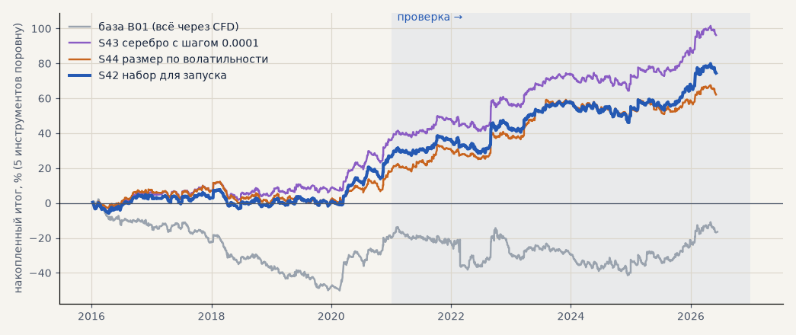
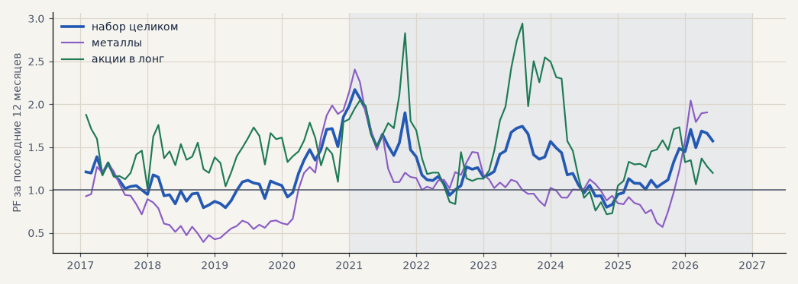

# Набор для запуска: металлы через CFD, акции на бирже в лонг

Гипотезы **H52** (набор как единый портфель) и **H07** (размер позиции по волатильности), задача **T15** — последний проход по импульсу перед запуском. Сделки — штатные прогоны журнала, метрики — тем же кодом, что журнал экспериментов: пять инструментов поровну, проверка — сделки, открытые с 2021 года. Расчёт — `scripts/launch_set.py`, эксперименты S42–S44 в журнале.

<!-- вывод -->
## Вывод

**H52 подтвердилась, но набор держится на акциях.** Набор для запуска прибылен как единый портфель в обоих
периодах: на проверке PF 1.26, итог без 2 лучших сделок +34.7%, t 2.2, в плюсе 5 лет из 6; на выборе PF 1.19,
без 2 лучших +19.9%. База B01 на тех же пяти инструментах (всё через CFD в обе стороны) на проверке около нуля, на выборе
в минусе (PF 1.01 и 0.91): весь выигрыш — от переноса акций на биржу в лонг.

* **Акции в лонг (GAZP, SBER, LKOH)** устойчивы: PF 1.52 на выборе и 1.37 на проверке, в плюсе каждый год
  обоих периодов, на свежих данных июнь–октябрь 2026 +6.7% ([forward_test.md](forward_test.md)).
* **Металлы** прибыльны только на проверке (+41%, PF 1.17): на выборе −11.5% (PF 0.94), скользящий PF ниже 1
  в 2017–2020 и 2024–2025, на свежих данных лета 2026 — вероятно, в минусе. Итог металлов держится на
  крупных движениях серебра 2020 и 2025–26.
* **Шаг цены серебра (T01)**: если серебро котируется с 4 знаками, набор на проверке +59% вместо +47% (S43) —
  меняется только оценка металлов.
* **Размер позиции по волатильности (H07) не помог** (S44): на проверке PF тот же (1.26), t чуть ниже,
  просадка чуть меньше; на выборе хуже — PF 1.14 против 1.19, просадка −14 против −11. Оставляем одинаковый
  размер.

**Что предлагаю для запуска:** первым этапом — GAZP, SBER, LKOH на бирже в лонг, одинаковый размер, правило
без изменений (`scripts/live_signals.py` это уже умеет). Металлы — вторым этапом: после спотового потока
котировок от брокера, ответа на T01 и сверки сделок на демо-счёте. Решение — вместе с Тимуром (T16).
<!-- /вывод -->

## Проверка 2021 — июнь 2026

| | сделок | итог % | PF | без 2 лучших | просадка | t | лет в плюсе |
|---|---|---|---|---|---|---|---|
| база B01 (всё через CFD) | 1159 | +3.0 | 1.01 | -9.3 | -27.7 | 0.11 | 2/6 |
| S42 набор для запуска | 884 | +47.0 | 1.26 | +34.7 | -12.2 | 2.20 | 5/6 |
| S43 серебро с шагом 0.0001 | 884 | +59.0 | 1.34 | +46.5 | -10.3 | 2.74 | 5/6 |
| S44 размер по волатильности | 884 | +42.3 | 1.26 | +30.4 | -11.4 | 2.15 | 5/6 |
| S42 — только металлы | 506 | +41.3 | 1.17 | +23.2 | -28.5 | 1.18 | 5/6 |
| S42 — только акции в лонг | 378 | +50.8 | 1.37 | +30.6 | -18.7 | 1.89 | 6/6 |

## Выбор 2016–2020

| | сделок | итог % | PF | без 2 лучших | просадка | t | лет в плюсе |
|---|---|---|---|---|---|---|---|
| база B01 (всё через CFD) | 908 | -19.5 | 0.91 | -27.1 | -52.4 | -1.05 | 1/5 |
| S42 набор для запуска | 736 | +27.5 | 1.19 | +19.9 | -11.2 | 1.64 | 3/5 |
| S43 серебро с шагом 0.0001 | 736 | +37.2 | 1.27 | +29.6 | -10.4 | 2.21 | 4/5 |
| S44 размер по волатильности | 736 | +19.8 | 1.14 | +13.9 | -14.0 | 1.32 | 2/5 |
| S42 — только металлы | 461 | -11.5 | 0.94 | -30.4 | -55.8 | -0.41 | 1/5 |
| S42 — только акции в лонг | 275 | +53.4 | 1.52 | +44.1 | -8.1 | 2.59 | 5/5 |

## По инструментам — S42, проверка

| | сделок | итог % | PF | без 2 лучших | просадка | t | лет в плюсе |
|---|---|---|---|---|---|---|---|
| серебро | 243 | +58.1 | 1.18 | +21.9 | -51.2 | 0.94 | 5/6 |
| золото | 263 | +24.5 | 1.15 | -2.2 | -39.2 | 0.73 | 2/6 |
| GAZP | 127 | +60.3 | 1.38 | -0.3 | -34.6 | 1.00 | 5/6 |
| SBER | 128 | +59.8 | 1.50 | +31.1 | -27.9 | 1.52 | 5/6 |
| LKOH | 123 | +32.3 | 1.23 | +10.1 | -24.1 | 0.87 | 4/6 |

## По годам — итог %, пять инструментов поровну

| год | база | S42 | S43 | S44 |
|---|---|---|---|---|
| 2016 | -13.3 | +4.4 | +6.3 | +7.7 |
| 2017 | -8.9 | -1.4 | +0.9 | -0.5 |
| 2018 | -15.8 | -3.2 | -1.2 | -5.4 |
| 2019 | -9.7 | +0.7 | +2.4 | -0.1 |
| 2020 | +28.2 | +26.9 | +28.8 | +18.0 |
| 2021 | -3.3 | +8.7 | +10.6 | +11.0 |
| 2022 | -6.2 | +6.9 | +9.2 | +7.2 |
| 2023 | -1.0 | +14.1 | +16.4 | +19.4 |
| 2024 | -3.1 | -2.5 | -0.5 | -3.4 |
| 2025 | +9.5 | +10.6 | +13.2 | +3.4 |
| 2026 | +7.2 | +9.2 | +10.2 | +4.7 |

## Размер позиции по волатильности (S44)

Средний размер сделки: серебро — выбор 1.06, проверка 0.73, золото — выбор 1.05, проверка 0.88, GAZP — выбор 1.03, проверка 1.16, SBER — выбор 1.00, проверка 1.45, LKOH — выбор 1.09, проверка 1.30.

## PF за скользящие 12 месяцев — S42

