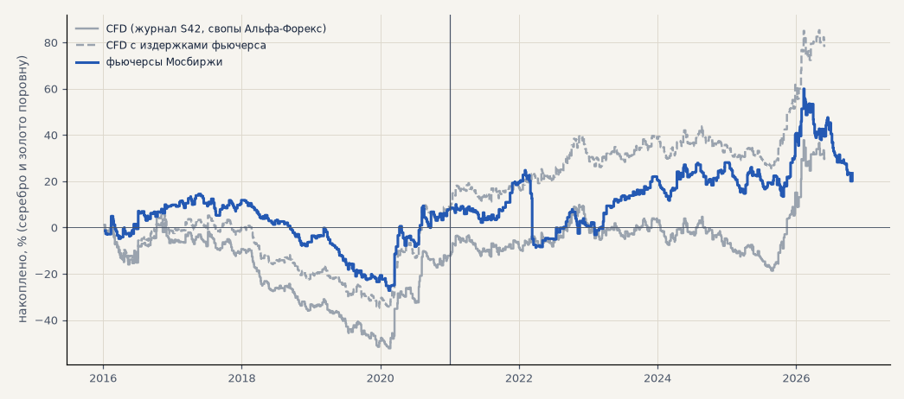

# Металлы на фьючерсах Мосбиржи вместо CFD (H68)

Импульс S42 без изменений по серебру и золоту в обе стороны на непрерывном ряде фьючерсов Мосбиржи SILV и GOLD (ближний контракт, переход за 5 дней до экспирации, прошлое поправлено на разрыв при переходе). Издержки — 0.04% комиссии и 0.05% проскальзывания на сторону, свопов нет. Сравнение — с S42 на спот-ценах CFD (журнал) и с теми же сделками CFD, пересчитанными с издержками фьючерса (без свопов); общий период для сравнения — сделки до мая 2026 (конец CFD-минуток). Критерий записан в банк (H68) до расчёта. Расчёт — `scripts/metals_futures.py`.

<!-- вывод -->
## Вывод

**H68 не подтвердилась: S42 по металлам на фьючерсах Мосбиржи слабее, чем на ценах CFD. Серебро и золото поровну — PF
1.05 и на выборе, и на проверке, итог без 2 лучших в минусе в обоих периодах. Дело не в свопах, а в самом инструменте:
те же правила на ценах фьючерса дают другие сделки.**

1. **Без свопов S42 по металлам на ценах CFD был бы хорош:** на проверке PF 1.34 и +75% (серебро PF 1.44), против PF 1.21 и
   +48% со свопами Альфа-Форекс. Свопы съедают около трети результата — это подтверждает T01.
2. **На фьючерсах этого нет:** проверка PF 1.05, +15% (до мая 2026 — PF 1.15, +34%), серебро на проверке в минусе (PF 0.97).
   Только 60% входов фьючерса совпадают с CFD — в ту же сторону и не дальше суток. Фьючерсы торгуются в московскую сессию,
   поэтому ночные и азиатские движения металлов приходят гэпом. Правило «ход за 6 часов ≥ 3 ATR» и гейт C на таких часовых
   свечах срабатывают иначе. Плюс сбой торгов в марте 2022 года: на графике — провал фьючерсов, которого нет на CFD.
3. **S46 и S48 по металлам** в минусе на проверке и на фьючерсах (PF 0.88 и 0.73), и на CFD (0.78 и 0.85) — металлы в этих
   стратегиях не работают ни там, ни там.

Что из этого следует: через Т-Инвестиции металлы по S42 не торговать — на фьючерсах преимущества нет. Металлы остаются
вопросом брокера CFD и свопов (T01, T02): без свопов S42 по серебру — одна из лучших частей набора. Запуск через
Т-Инвестиции — акции (S42, S46, S48 — H66, H67).

Данные: минутки ISS по всем контрактам SILV и GOLD с 2015 года (`scripts/queues/futures_download.sh`, 0.33 ГБ в
`data/raw/moex/SILV`, `GOLD`), склейка — `moex_data.continuous_csv` (потоком, тот же ряд, что `continuous`). Уровень
цен прошлого из-за поправки на переходах выше спота (серебро 2015 года ~30.6 против ~15.6 на споте); на правило, которое
считает ходы в ATR, это не влияет — доходности внутри контракта сохранены.
<!-- /вывод -->

## Критерий H68

| пункт | выполнен |
|---|---|
| проверка: PF > 1.1 | ❌ |
| выбор: PF > 1.0 | ✅ |
| без 2 лучших > 0 в обоих периодах | ❌ |

## Варианты

| вариант | срез | выбор: сделок | итог % | PF | без 2 лучших | проверка: сделок | итог % | PF | без 2 лучших | t |
|---|---|---|---|---|---|---|---|---|---|---|
| S42 фьючерсы | серебро + золото | 346 | +8.5 | 1.05 | -8.9 | 464 | +14.9 | 1.05 | -3.0 | 0.37 |
| S42 фьючерсы | серебро | 171 | +43.1 | 1.22 | +8.3 | 231 | -11.6 | 0.97 | -47.5 | -0.16 |
| S42 фьючерсы | золото | 175 | -26.1 | 0.81 | -41.6 | 233 | +41.5 | 1.26 | +21.9 | 1.24 |
| S42 CFD (журнал, свопы Альфа-Форекс) | серебро + золото | 461 | -11.5 | 0.94 | -30.4 | 494 | +48.1 | 1.21 | +30.0 | 1.39 |
| S42 CFD (журнал, свопы Альфа-Форекс) | серебро | 218 | +25.4 | 1.11 | -12.4 | 237 | +67.3 | 1.22 | +31.0 | 1.10 |
| S42 CFD (журнал, свопы Альфа-Форекс) | золото | 243 | -48.4 | 0.73 | -63.4 | 257 | +28.9 | 1.18 | +2.3 | 0.87 |
| S42 CFD с издержками фьючерса | серебро + золото | 461 | +10.0 | 1.05 | -9.1 | 494 | +75.3 | 1.34 | +56.7 | 2.14 |
| S42 CFD с издержками фьючерса | серебро | 218 | +71.0 | 1.36 | +32.7 | 237 | +123.7 | 1.44 | +86.6 | 2.00 |
| S42 CFD с издержками фьючерса | золото | 243 | -51.0 | 0.72 | -66.0 | 257 | +26.9 | 1.16 | +0.2 | 0.81 |
| S42 фьючерсы до мая 2026 | серебро + золото | 346 | +8.5 | 1.05 | -8.9 | 403 | +34.2 | 1.15 | +16.2 | 0.89 |
| S42 фьючерсы до мая 2026 | серебро | 171 | +43.1 | 1.22 | +8.3 | 202 | +18.0 | 1.06 | -18.0 | 0.26 |
| S42 фьючерсы до мая 2026 | золото | 175 | -26.1 | 0.81 | -41.6 | 201 | +50.3 | 1.38 | +30.8 | 1.58 |
| S46 фьючерсы | серебро + золото | 84 | +33.3 | 2.38 | +20.6 | 144 | -7.0 | 0.88 | -15.5 | -0.58 |
| S46 фьючерсы | серебро | 37 | +50.0 | 2.95 | +24.7 | 73 | -22.8 | 0.68 | -38.2 | -1.22 |
| S46 фьючерсы | золото | 47 | +16.5 | 1.74 | +1.3 | 71 | +8.9 | 1.21 | -3.9 | 0.59 |
| S46 CFD (журнал) | серебро + золото | 101 | +25.4 | 1.83 | +12.1 | 124 | -8.9 | 0.78 | -15.4 | -1.00 |
| S46 CFD (журнал) | серебро | 46 | +33.0 | 1.88 | +6.5 | 58 | -19.6 | 0.61 | -32.5 | -1.43 |
| S46 CFD (журнал) | золото | 55 | +17.8 | 1.75 | -0.4 | 66 | +1.8 | 1.06 | -7.3 | 0.16 |
| S48 фьючерсы | серебро + золото | 143 | +22.8 | 1.36 | +2.7 | 214 | -37.8 | 0.73 | -48.9 | -1.62 |
| S48 фьючерсы | серебро | 71 | +43.5 | 1.57 | +3.2 | 109 | -73.4 | 0.61 | -95.6 | -1.77 |
| S48 фьючерсы | золото | 72 | +2.1 | 1.04 | -15.9 | 105 | -2.2 | 0.97 | -15.1 | -0.10 |
| S48 CFD (журнал) | серебро + золото | 155 | +17.3 | 1.28 | -2.5 | 194 | -17.2 | 0.85 | -27.1 | -0.90 |
| S48 CFD (журнал) | серебро | 78 | +33.5 | 1.44 | -6.2 | 100 | -46.8 | 0.70 | -66.7 | -1.44 |
| S48 CFD (журнал) | золото | 77 | +1.1 | 1.02 | -17.0 | 94 | +12.5 | 1.18 | -0.2 | 0.63 |

Совпадение сделок S42 (вход в ту же сторону не дальше суток, до мая 2026): серебро 60% сделок фьючерса есть и на CFD, золото 59% сделок фьючерса есть и на CFD.
