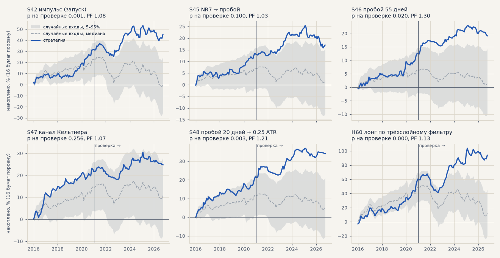
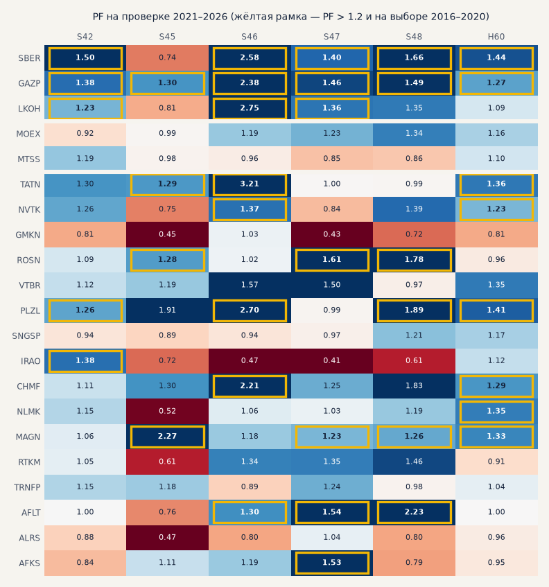

# Найденные стратегии на других акциях Мосбиржи (H66)

Стратегии, выбранные на SBER, GAZP, LKOH, — без изменений на 16 акциях индекса Мосбиржи, которые ни разу не участвовали в выборе: TATN, NVTK, GMKN, ROSN, VTBR, PLZL, SNGSP, IRAO, CHMF, NLMK, MAGN, RTKM, TRNFP, AFLT, ALRS, AFKS. Отбор — до расчёта: в индексе на 23.10, история на TQBR с 2015 года, медианный оборот 2016–2020 ≥ 100 млн ₽ в день, одна бумага на эмитента ([universe.csv](new_stocks/universe.csv)). MOEX и MTSS — отдельно: их видели 29.09, когда выбирали набор. Только лонг, издержки биржи (0.1% комиссии и 0.05% проскальзывания на сторону), цены с поправкой на дивиденды; выбор 2016–2020, проверка 2021 — октябрь 2026. Бумаги поровну. Критерий записан в банк (H66) до расчёта. Расчёт — `scripts/new_stocks.py`.

<!-- вывод -->
## Вывод

**По критерию, записанному до расчёта, на 16 новых акциях подтвердились две стратегии итератора — S46 «пробой 55
дней» и S48 «пробой 20 дней + 0.25 ATR». Импульс S42 не дотянул по одному пункту: PF на проверке 1.08 при пороге 1.1,
хотя момент входа он выбирает лучше случайного увереннее всех (p = 0.001). S45 и S47 на новые бумаги не переносятся.
H60 на проверке лучше «купить и держать», на выборе — хуже.**

1. **S46 «пробой 55 дней»** — проверка PF 1.30, +11.4%, без 2 лучших +8.7, в плюсе 12 бумаг из 16; выбор PF 1.44;
   лучше случайных входов, p = 0.020. На SBER, GAZP, LKOH было PF 2.60 — на новых бумагах вдвое слабее, но в плюсе.
2. **S48 «пробой 20 дней + 0.25 ATR»** — проверка PF 1.21, +12.6%, без 2 лучших +10.1, в плюсе 9 из 16; выбор PF 1.34;
   p = 0.003. На бумагах выбора — PF 1.49.
3. **S42 импульс** — проверка PF 1.08, +13.7%, без 2 лучших +10.6, в плюсе 12 из 16; выбор PF 1.28. Средняя сделка
   +0.10% против −0.17% у случайных входов той же длины. Преимущество есть, но намного меньше, чем на бумагах выбора
   (PF 1.37): часть результата S42 — удачный выбор бумаг.
4. **S45 и S47 не переносятся** — PF 1.03 и 1.07, без 2 лучших в минусе, от случайных входов не отличаются (p 0.10 и
   0.26). S45 и на журнале был провалом на проверке (подгонка).
5. **H60 против «купить и держать»** — на проверке правило +30.5% при просадке −26% против −4.2% и −55% у держания,
   лучше на 11 бумагах из 16. На выборе 2016–2020 (растущий рынок) правило +71% / −14% против +200% / −32%: по итогу к
   просадке хуже (5.3 против 6.3) и лучше только на 5 бумагах из 16. Тот же рисунок, что на трёх бумагах: правило
   уводит от падений (2022), но в росте отстаёт.
6. **На выборе 2016–2020 ни одна стратегия не отличается от случайных входов** (p 0.07–0.18): в растущем рынке лонг в
   случайный момент тоже зарабатывал. Разница видна на проверке, где рынок падал. И поправка на число проверок: стратегий
   шесть, при строгом пороге 0.05 / 6 ≈ 0.008 выдерживают S42, S48 и H60, а S46 (0.020) — нет.
7. **«Работает на отдельных бумагах» (H65) — почти всегда на уровне случайности.** PF > 1.2 в обоих периодах у S42 —
   на 2 бумагах при 1.1 в среднем у случайных входов, у S45 — 3 при 2.5, у S47 — 4 при 2.7, у S48 — 4 при 2.1 (p 0.16),
   у S46 — 5 при 2.3 (p 0.07). Исключение — H60: 6 бумаг (CHMF, MAGN, NLMK, NVTK, PLZL, TATN) при 1.05 (p < 0.001).
   Значит, вывод вида «не работает нигде, кроме бумаг 1, 2, 3» по истории делать опасно: на 16 бумагах 2–3 «работающие»
   бывают и у случайных входов. Отобранные так бумаги надо проверять отдельно, на новых данных.
8. **MOEX и MTSS** (их видели при выборе набора) — все шесть стратегий около нуля, PF на проверке 0.99–1.13.

Что из этого следует (к обсуждению):

* **S46 и S48 — кандидаты во вторую стратегию контура** в бумажном режиме, на широком наборе бумаг. В
  [inference.md](inference.md) предлагались S45 или S46; S45 здесь не подтвердилась.
* **S42 оставить на SBER, GAZP, LKOH.** На новых бумагах он слабее, а добавлять бумаги по их истории — та же ловушка, что
  в пункте 7.
* **Для H60** вывод прежний: защита от падений, а не прибыль сверх рынка; второй стратегией к импульсу не годится (H60).

## Данные

* Минутки ISS с января 2015 года по 23.10.2026, 16 файлов (2.5 ГБ) в `data/raw/moex/` — не в git; выкачать заново —
  `scripts/queues/new_stocks_download.sh` (около 1.5 часа).
* Сплиты: ISS отдаёт цены уже с поправкой (GMKN 1:100 и TRNFP 1:100 в 2024 году, VTBR 5000:1 в 2024, PLZL 1:10 в 2025),
  а объём в штуках — без; объём пересчитан по обороту (`prepare`). У IRAO история с 20.01.2015 — до этого консолидация
  без поправки цены (только прогрев индикаторов, проверка с 2016 года).
* Минуты с ходом больше 15%: почти все — 24.02.2022; кроме них — три минуты PLZL в 2016–2018 годах (минимум на 20% ниже
  открытия при тонкой ликвидности), открытие утренней сессии ROSN 14.02.2025 и SNGSP в день отсечки 2015 года. Это
  сделки биржи — стоп-заявка сработала бы и в жизни, — поэтому оставлены.
* Дивиденды: 267 отсечек по 16 бумагам (`scripts/fetch_dividends.py --tickers`, строки SBER, GAZP, LKOH и других
  не менялись); медиана «гэп открытия / дивиденд» по бумагам 0.64–0.90, как у SBER и LKOH (0.86–0.87). Сомнительная
  одна: TRNFP 10.07.2018 (4.4% цены) — гэпа в эти дни нет; на этот день пришлись две сделки S46 и S47 (−2.2% и −3.1%,
  период выбора) — около −0.3% портфеля, вывод не меняет.
<!-- /вывод -->

## Критерий H66 на 16 новых бумагах

| стратегия | проверка: сделок | итог % | PF | без 2 лучших | t | выбор: PF | итог % | в плюсе на проверке | средняя сделка, % | у случайных входов, % | p | критерий |
|---|---|---|---|---|---|---|---|---|---|---|---|---|
| S42 импульс (запуск) | 2103 | +13.7 | 1.08 | +10.6 | 1.22 | 1.28 | +31.6 | 12 из 16 | +0.104 | -0.169 | 0.001 | ❌ проверка PF > 1.1 |
| S45 NR7 → пробой | 532 | +2.8 | 1.03 | -6.3 | 0.23 | 1.42 | +17.7 | 8 из 16 | +0.092 | -0.166 | 0.100 | ❌ проверка PF > 1.1; без 2 лучших > 0; лучше случайных (p < 0.05) |
| S46 пробой 55 дней | 468 | +11.4 | 1.30 | +8.7 | 1.98 | 1.44 | +14.9 | 12 из 16 | +0.225 | -0.163 | 0.020 | ✅ подтвердилась |
| S47 канал Кельтнера | 612 | +5.4 | 1.07 | -0.8 | 0.61 | 1.42 | +21.3 | 10 из 16 | +0.039 | -0.106 | 0.256 | ❌ проверка PF > 1.1; без 2 лучших > 0; лучше случайных (p < 0.05) |
| S48 пробой 20 дней + 0.25 ATR | 709 | +12.6 | 1.21 | +10.1 | 1.86 | 1.34 | +21.5 | 9 из 16 | +0.284 | -0.153 | 0.003 | ✅ подтвердилась |
| H60 лонг по трёхслойному фильтру | 3564 | +31.3 | 1.13 | +26.8 | 2.11 | 1.44 | +62.8 | 10 из 16 | +0.141 | -0.164 | 0.000 | ❌ итог/просадка лучше держания: поровну, оба периода; на большинстве бумаг: выбор |

Средняя сделка — на единицу позиции, после издержек. Случайные входы — у каждой сделки случайный вход в лонг на той же бумаге в том же периоде с той же длительностью (2000 повторов); p — доля повторов, где случайные входы дали не меньше. Рост рынка лонгу помогает и без стратегии, поэтому сравнение с нулём здесь недостаточно.

## Где работает: по бумагам

PF на проверке; рамка и 🟨 — PF > 1.2 и на выборе, и на проверке. Строка «случайно» — сколько таких бумаг в среднем дали бы случайные входы с теми же числом и длительностью сделок, и p — как часто случайно столько же или больше.

| бумага | S42 | S45 | S46 | S47 | S48 | H60 |
|---|---|---|---|---|---|---|
| **новые 16** | | | | | | |
| TATN | 1.30 (1.16) | 🟨 1.29 (1.47) | 🟨 3.21 (1.78) | 1.00 (1.39) | 0.99 (1.22) | 🟨 1.36 (1.56) |
| NVTK | 1.26 (0.83) | 0.75 (1.76) | 🟨 1.37 (1.41) | 0.84 (1.77) | 1.39 (1.18) | 🟨 1.23 (1.23) |
| GMKN | 0.81 (1.56) | 0.45 (1.36) | 1.03 (2.52) | 0.43 (2.18) | 0.72 (1.70) | 0.81 (1.75) |
| ROSN | 1.09 (1.42) | 🟨 1.28 (1.37) | 1.02 (1.63) | 🟨 1.61 (1.25) | 🟨 1.78 (1.69) | 0.96 (1.58) |
| VTBR | 1.12 (0.78) | 1.19 (1.97) | 1.57 (0.65) | 1.50 (0.83) | 0.97 (0.28) | 1.35 (0.90) |
| PLZL | 🟨 1.26 (1.48) | 1.91 (1.20) | 🟨 2.70 (1.98) | 0.99 (2.32) | 🟨 1.89 (1.55) | 🟨 1.41 (2.04) |
| SNGSP | 0.94 (0.92) | 0.89 (1.53) | 0.94 (0.45) | 0.97 (1.00) | 1.21 (0.83) | 1.17 (0.87) |
| IRAO | 🟨 1.38 (1.46) | 0.72 (1.75) | 0.47 (1.98) | 0.41 (1.20) | 0.61 (1.71) | 1.12 (1.34) |
| CHMF | 1.11 (1.48) | 1.30 (0.54) | 🟨 2.21 (1.26) | 1.25 (1.11) | 1.83 (1.12) | 🟨 1.29 (1.49) |
| NLMK | 1.15 (1.86) | 0.52 (2.32) | 1.06 (1.49) | 1.03 (1.33) | 1.19 (1.46) | 🟨 1.35 (2.38) |
| MAGN | 1.06 (2.22) | 🟨 2.27 (2.51) | 1.18 (1.60) | 🟨 1.23 (1.50) | 🟨 1.26 (1.93) | 🟨 1.33 (1.54) |
| RTKM | 1.05 (0.56) | 0.61 (1.08) | 1.34 (0.80) | 1.35 (0.94) | 1.46 (0.53) | 0.91 (1.02) |
| TRNFP | 1.15 (1.38) | 1.18 (0.27) | 0.89 (0.59) | 1.24 (0.59) | 0.98 (0.68) | 1.04 (1.07) |
| AFLT | 1.00 (1.39) | 0.76 (2.40) | 🟨 1.30 (1.87) | 🟨 1.54 (2.05) | 🟨 2.23 (1.59) | 1.00 (1.61) |
| ALRS | 0.88 (1.09) | 0.47 (1.16) | 0.80 (1.15) | 1.04 (1.22) | 0.80 (1.28) | 0.96 (1.08) |
| AFKS | 0.84 (1.31) | 1.11 (1.01) | 1.19 (1.54) | 🟨 1.53 (4.40) | 0.79 (2.06) | 0.95 (1.67) |
| 🟨 бумаг | 2; случайно 1.1, p 0.30 | 3; случайно 2.5, p 0.46 | 5; случайно 2.3, p 0.07 | 4; случайно 2.7, p 0.29 | 4; случайно 2.1, p 0.16 | 6; случайно 1.1, p 0.00 |
| **MOEX, MTSS** | | | | | | |
| MOEX | 0.92 (1.34) | 0.99 (1.53) | 1.19 (1.02) | 1.23 (0.72) | 1.34 (1.08) | 1.16 (1.57) |
| MTSS | 1.19 (0.91) | 0.98 (3.08) | 0.96 (1.04) | 0.85 (1.10) | 0.86 (1.05) | 1.10 (1.14) |
| 🟨 бумаг | 0; случайно 0.2, p 1.00 | 0; случайно 0.4, p 1.00 | 0; случайно 0.3, p 1.00 | 0; случайно 0.4, p 1.00 | 0; случайно 0.3, p 1.00 | 0; случайно 0.3, p 1.00 |
| **SBER, GAZP, LKOH** | | | | | | |
| SBER | 🟨 1.50 (1.39) | 0.74 (4.55) | 🟨 2.58 (2.09) | 🟨 1.40 (3.16) | 🟨 1.66 (2.08) | 🟨 1.44 (2.43) |
| GAZP | 🟨 1.38 (1.45) | 🟨 1.30 (2.03) | 🟨 2.38 (1.88) | 🟨 1.46 (1.96) | 🟨 1.49 (1.76) | 🟨 1.27 (1.78) |
| LKOH | 🟨 1.23 (1.82) | 0.81 (3.03) | 🟨 2.75 (1.53) | 🟨 1.36 (2.20) | 1.35 (0.94) | 1.09 (1.87) |

В скобках — PF на выборе 2016–2020.

## H60 против «купить и держать»

Капитал с реинвестированием, стоимость позиции каждый час (как в [trend_hold.md](trend_hold.md)); и/п — итог к просадке.

| группа | период | бумаг, где правило лучше по и/п | правило: итог % | просадка % | и/п | держать: итог % | просадка % | и/п |
|---|---|---|---|---|---|---|---|---|
| новые 16 | выбор | 5 из 16 | +71.4 | -13.6 | 5.26 | +199.6 | -31.6 | 6.32 |
| новые 16 | проверка | 11 из 16 | +30.5 | -26.2 | 1.16 | -4.2 | -54.8 | -0.08 |
| MOEX, MTSS | выбор | 0 из 2 | +51.2 | -19.6 | 2.61 | +160.1 | -26.7 | 5.99 |
| MOEX, MTSS | проверка | 0 из 2 | +12.5 | -28.6 | 0.44 | +41.3 | -49.7 | 0.83 |

## Для сравнения: MOEX, MTSS и бумаги выбора

| группа | стратегия | проверка: итог % | PF | без 2 лучших | выбор: итог % | PF | p на проверке |
|---|---|---|---|---|---|---|---|
| MOEX, MTSS | S42 импульс (запуск) | +4.9 | 1.03 | -19.6 | +12.3 | 1.12 | 0.365 |
| SBER, GAZP, LKOH | S42 импульс (запуск) | +50.8 | 1.37 | +30.6 | +53.4 | 1.52 | — |
| MOEX, MTSS | S45 NR7 → пробой | -1.0 | 0.99 | -19.0 | +21.0 | 1.94 | 0.294 |
| SBER, GAZP, LKOH | S45 NR7 → пробой | -5.1 | 0.93 | -23.5 | +44.4 | 2.98 | — |
| MOEX, MTSS | S46 пробой 55 дней | +3.1 | 1.07 | -5.6 | +0.8 | 1.03 | 0.268 |
| SBER, GAZP, LKOH | S46 пробой 55 дней | +45.0 | 2.60 | +32.2 | +28.2 | 1.84 | — |
| MOEX, MTSS | S47 канал Кельтнера | +5.0 | 1.06 | -8.0 | -8.8 | 0.87 | 0.555 |
| SBER, GAZP, LKOH | S47 канал Кельтнера | +30.0 | 1.40 | +14.6 | +55.7 | 2.44 | — |
| MOEX, MTSS | S48 пробой 20 дней + 0.25 ATR | +7.8 | 1.12 | -3.2 | +4.1 | 1.06 | 0.317 |
| SBER, GAZP, LKOH | S48 пробой 20 дней + 0.25 ATR | +27.1 | 1.49 | +17.7 | +30.5 | 1.52 | — |
| MOEX, MTSS | H60 лонг по трёхслойному фильтру | +25.0 | 1.13 | -3.1 | +46.4 | 1.35 | 0.186 |
| SBER, GAZP, LKOH | H60 лонг по трёхслойному фильтру | +51.9 | 1.25 | +33.8 | +99.8 | 2.01 | — |

На бумагах выбора — сделки из журнала (S42, S45–S48, S50), тот же протокол.
