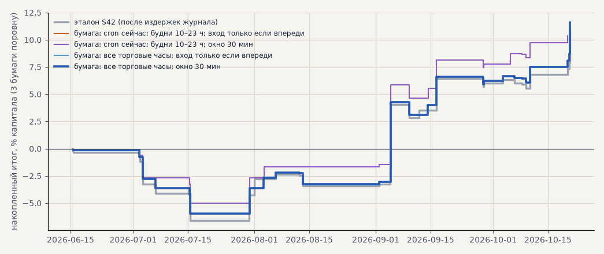

# Бумажный прогон живого контура на свежих данных

SBER, GAZP, LKOH на бирже только в лонг, 12.06.2026 — 21.10.2026 23:18: после конца истории всех трёх бумаг, ни один день не участвовал в выборе стратегии. Решения — `live_signals.analyse`, заявки — `live_trade.plan` и `live_trade.execute`, брокер — бумажный (минутки биржи, комиссия 0.05% на сторону, без проскальзывания сверх того, что даёт время исполнения). Эталон — сделки S42 тем же пайплайном одним прогоном. Расчёт — `scripts/paper_replay.py`.

<!-- вывод -->
## Вывод

**В том виде, в каком контур был готов к запуску, он не открыл бы ни одной сделки из 33 за 12.06–21.10.2026. После
исправления — все 33, и бумажный итог совпадает с эталоном: +11.6% против +10.8%.**

* **Причина нуля — минута входа.** Стратегия входит в HH:01. Запуск в HH:02 с минутками без задержки (Т-Инвестиции)
  видит эту минуту последней, а расчёт ещё не открывает по ней сделку; через минуту сделка уже «открыта», и
  контур говорит «держать», а исполнитель вход пропускает. С задержкой ISS (15 мин) этого не было.
* **Исправление:** вход контура не старше 30 минут отдаётся как «открыть по рынку» (`ENTRY_GRACE` в
  `scripts/live_signals.py`), запуск — в HH:05, каждый час и в выходные (`scripts/queues/live_hourly.sh`).
  Расписание «будни 10–23 ч» теряет треть входов (22 из 33): утренняя сессия с 07:00 и торги выходного дня.
* **Исполнение не хуже бэктеста:** вход на 4 минуты позже, цена входа хуже на 0.03% (медиана) — меньше заложенных
  0.05% проскальзывания. Стоп-лосс и трейлинг-стоп «у брокера» закрывают сделки там же, где симулятор; продажа по
  сроку сдвигается, только если срок пришёлся на закрытую биржу (продаём на открытии).
* **Контур не открывает лишнего:** в 36 случайных часах вне сигналов — ни одного «открыть»; вторая стоп-заявка ни
  разу не сработала после того, как первая закрыла позицию.
* Дивиденд SBER 18.07: у брокера цены сырые, в эталоне — с поправкой; на результат сделок это не повлияло (позиции
  через отсечку не было). Если позиция будет держаться через отсечку, стоп у брокера сработает на гэпе — перед
  отсечкой стопы стоит переставлять (не реализовано).
<!-- /вывод -->

## Варианты

| вариант | бумажных сделок | поймано входов эталона | опоздание входа, мин (медиана) | цена входа хуже, % (медиана) | итог бумаги, % после комиссии | итог эталона по тем же сделкам, % | стоп без позиции |
|---|---|---|---|---|---|---|---|
| cron сейчас: будни 10–23 ч; вход только если впереди | 0 | 0 из 33 | nan | — | +0.0 | +0.0 | 0 |
| cron сейчас: будни 10–23 ч; окно 30 мин | 22 | 22 из 33 | 4 | +0.042 | +10.3 | +9.5 | 0 |
| все торговые часы; вход только если впереди | 0 | 0 из 33 | nan | — | +0.0 | +0.0 | 0 |
| все торговые часы; окно 30 мин | 33 | 33 из 33 | 4 | +0.032 | +11.6 | +10.8 | 0 |

Эталон целиком: 33 сделок, +10.8% после издержек журнала (0.05% комиссии и 0.05% проскальзывания на сторону), на капитал трёх бумаг поровну.

## Сделки: эталон против бумаги («все торговые часы; окно 30 мин»)

| бумага | вход эталона | выход эталона | причина | эталон % до / после | вход на бумаге | опоздание, мин | цена входа хуже, % | выход на бумаге | причина | бумага % до / после |
|---|---|---|---|---|---|---|---|---|---|---|
| sber | 15.06 07:01 | 15.06 18:16 | trailing_stop | -0.19 / -0.39 | 15.06 07:05 | 4 | +15.479 | 15.06 18:05 | трейлинг | -0.05 / -0.15 |
| sber | 29.06 16:01 | 02.07 16:51 | trailing_stop | -1.30 / -1.50 | 29.06 16:05 | 4 | +15.589 | 02.07 15:00 | трейлинг | -0.82 / -0.92 |
| sber | 13.07 11:01 | 15.07 12:00 | stop_loss | -1.99 / -2.19 | 13.07 11:05 | 4 | +15.337 | 15.07 11:52 | стоп | -1.72 / -1.82 |
| sber | 20.07 17:01 | 30.07 17:01 | timeout | +7.17 / +6.97 | 20.07 17:05 | 4 | +0.129 | 30.07 17:05 | рынок | +6.98 / +6.88 |
| sber | 03.08 09:01 | 06.08 11:56 | trailing_stop | +1.44 / +1.24 | 03.08 09:05 | 4 | +0.014 | 06.08 11:56 | трейлинг | +1.43 / +1.33 |
| sber | 31.08 12:01 | 01.09 20:51 | trailing_stop | +0.78 / +0.58 | 31.08 12:05 | 4 | +0.033 | 01.09 20:51 | трейлинг | +0.75 / +0.65 |
| sber | 03.09 19:01 | 11.09 23:49 | timeout | +2.33 / +2.13 | 03.09 19:05 | 4 | +0.000 | 14.09 07:05 | рынок | +2.84 / +2.74 |
| sber | 22.09 16:01 | 28.09 11:31 | stop_loss | -2.01 / -2.21 | 22.09 16:05 | 4 | +0.050 | 28.09 11:31 | стоп | -2.01 / -2.11 |
| sber | 05.10 11:01 | 08.10 09:29 | trailing_stop | -0.11 / -0.31 | 05.10 11:05 | 4 | -0.121 | 08.10 09:29 | трейлинг | +0.01 / -0.09 |
| sber | 10.10 10:01 | 20.10 10:01 | timeout | +1.85 / +1.65 | 10.10 10:05 | 4 | +0.046 | 20.10 10:05 | рынок | +1.96 / +1.86 |
| gazp | 15.06 06:59 | 15.06 13:44 | trailing_stop | -0.42 / -0.62 | 15.06 07:05 | 6 | -0.220 | 15.06 13:44 | трейлинг | -0.20 / -0.30 |
| gazp | 29.06 20:01 | 03.07 10:52 | stop_loss | -6.01 / -6.21 | 29.06 20:05 | 4 | -0.059 | 03.07 10:57 | стоп | -6.01 / -6.11 |
| gazp | 05.07 10:01 | 06.07 16:00 | stop_loss | -2.39 / -2.59 | 05.07 10:05 | 4 | -0.366 | 06.07 16:12 | стоп | -2.41 / -2.51 |
| gazp | 13.07 16:01 | 15.07 13:52 | stop_loss | -5.09 / -5.29 | 13.07 16:05 | 4 | +0.264 | 15.07 13:45 | стоп | -5.08 / -5.18 |
| gazp | 22.07 13:01 | 31.07 23:49 | timeout | +2.38 / +2.18 | 22.07 13:05 | 4 | +0.245 | 03.08 07:05 | рынок | +1.94 / +1.84 |
| gazp | 09.08 09:59 | 13.08 10:30 | stop_loss | -2.78 / -2.98 | 09.08 10:05 | 6 | +0.032 | 13.08 10:30 | стоп | -2.78 / -2.88 |
| gazp | 25.08 18:01 | 04.09 18:01 | timeout | +4.50 / +4.30 | 25.08 18:05 | 4 | +0.231 | 04.09 18:05 | рынок | +4.51 / +4.41 |
| gazp | 08.09 15:01 | 09.09 12:30 | stop_loss | -3.49 / -3.69 | 08.09 15:05 | 4 | -0.141 | 09.09 12:56 | стоп | -3.51 / -3.61 |
| gazp | 10.09 18:01 | 16.09 13:09 | trailing_stop | +3.32 / +3.12 | 10.09 18:05 | 4 | +1.193 | 16.09 13:09 | трейлинг | +2.10 / +2.00 |
| gazp | 18.09 17:01 | 28.09 14:52 | trailing_stop | +1.09 / +0.89 | 18.09 17:05 | 4 | +0.104 | 28.09 14:52 | трейлинг | +0.98 / +0.88 |
| gazp | 04.10 10:01 | 06.10 11:39 | trailing_stop | -0.54 / -0.74 | 04.10 10:05 | 4 | -0.247 | 06.10 11:39 | трейлинг | -0.29 / -0.39 |
| gazp | 09.10 17:01 | 10.10 11:31 | trailing_stop | +4.16 / +3.96 | 09.10 17:05 | 4 | -0.164 | 10.10 11:31 | трейлинг | +4.33 / +4.23 |
| gazp | 10.10 13:01 | 20.10 13:01 | timeout | +8.87 / +8.67 | 10.10 13:05 | 4 | +0.020 | 20.10 13:05 | рынок | +8.76 / +8.66 |
| lkoh | 26.06 16:01 | 02.07 14:54 | trailing_stop | -0.85 / -1.05 | 26.06 16:05 | 4 | -0.023 | 02.07 14:54 | трейлинг | -0.83 / -0.93 |
| lkoh | 12.07 11:01 | 13.07 17:14 | trailing_stop | +0.26 / +0.06 | 12.07 11:05 | 4 | +0.056 | 13.07 17:14 | трейлинг | +0.20 / +0.10 |
| lkoh | 22.07 13:01 | 31.07 23:49 | timeout | +2.50 / +2.30 | 22.07 13:05 | 4 | +0.232 | 03.08 07:05 | рынок | +1.20 / +1.10 |
| lkoh | 09.08 10:01 | 12.08 11:44 | trailing_stop | -0.04 / -0.24 | 09.08 10:05 | 4 | +0.021 | 12.08 11:44 | трейлинг | -0.06 / -0.16 |
| lkoh | 25.08 19:01 | 04.09 19:01 | timeout | +17.81 / +17.61 | 25.08 19:05 | 4 | +0.140 | 04.09 19:05 | рынок | +17.62 / +17.52 |
| lkoh | 07.09 21:01 | 16.09 13:03 | trailing_stop | +5.75 / +5.55 | 07.09 21:05 | 4 | -0.176 | 16.09 13:03 | трейлинг | +5.94 / +5.84 |
| lkoh | 23.09 11:01 | 03.10 11:01 | timeout | +1.18 / +0.98 | 23.09 11:05 | 4 | -0.279 | 03.10 11:05 | рынок | +1.44 / +1.34 |
| lkoh | 03.10 15:01 | 06.10 11:42 | trailing_stop | +0.02 / -0.18 | 03.10 15:05 | 4 | +0.064 | 06.10 11:42 | трейлинг | -0.04 / -0.14 |
| lkoh | 06.10 19:01 | 09.10 10:31 | trailing_stop | -0.98 / -1.18 | 06.10 19:05 | 4 | -0.027 | 09.10 10:31 | трейлинг | -0.96 / -1.06 |
| lkoh | 09.10 23:01 | 19.10 23:01 | timeout | +1.76 / +1.56 | 09.10 23:05 | 4 | -0.109 | 19.10 23:05 | рынок | +1.87 / +1.77 |

## Проверки

* Случайные часы вне сигналов эталона: контур открыл бы сделку 0 раз.
* Стоп-заявки без позиции (вторая заявка срабатывает после того, как первая закрыла позицию, до снятия раз в час): cron сейчас: будни 10–23 ч; вход только если впереди: 0, cron сейчас: будни 10–23 ч; окно 30 мин: 0, все торговые часы; вход только если впереди: 0, все торговые часы; окно 30 мин: 0
