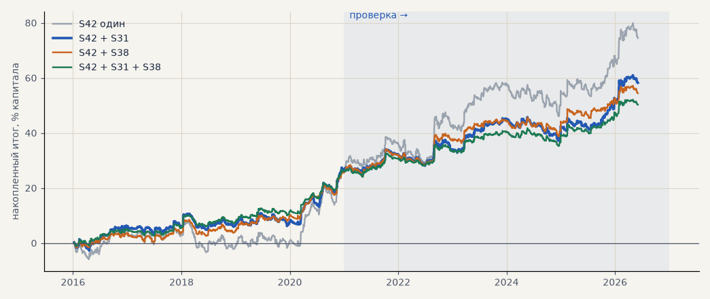

# Портфель: набор для запуска + самостоятельная стратегия

Гипотеза **H53**, задачи **T18–T20, T22**. Новую стратегию не сравниваем с B01 (созвон 16.10): важно, прибыльна ли она сама по себе и что даёт вместе с набором для запуска S42. Все стратегии — на тех же пяти инструментах: серебро и золото через CFD в обе стороны, GAZP, SBER, LKOH на бирже только в лонг (шорты кандидатов по акциям убраны из готовых сделок), издержки — профиль exchange. Капитал поровну между стратегиями, внутри — поровну между инструментами. Сумма процентов портфеля — среднее двух стратегий, поэтому портфель сравнивается с S42 по **t месячных результатов** и **итогу к просадке**. Расчёт — `scripts/portfolio.py`, модуль — `forexmodel/evaluation/portfolio.py`.

Отбор кандидата: PF > 1.1 сам по себе на выборе и проверке, не меньше 10 сделок в год (T19); портфель лучше S42 по t и итогу к просадке в обоих периодах.

<!-- вывод -->
## Вывод

**H53 по строгому критерию не подтвердилась: на проверке ни одна добавка не улучшает набор для запуска
заметно больше шума.** Вторая стратегия на половине капитала вдвое снижает и итог, и просадку (−12.2 →
−6.5…−8.6), а на единицу риска на проверке портфель почти такой же, как S42 один: t месяцев 2.0–2.1 против
1.93, итог к просадке 3.6–4.1 против 3.85. Явный выигрыш от сочетания виден только на выборе 2016–2020,
когда S42 стоял на месте.

* **S31 — пробой 55-дневного уровня (классические параметры «Черепах», не подбирались)** — единственная
  стратегия, прибыльная сама по себе в обоих периодах: PF 1.76 на выборе и 1.32 на проверке, 41 сделка в год
  на пять инструментов, корреляция месяцев с S42 около 0.4–0.5. С S42 на выборе — итог к просадке 4.6 против
  2.5; на проверке t выше (2.05 против 1.93), но итог к просадке чуть ниже (3.6 против 3.85) — поэтому отбор не
  прошла. Это лучший кандидат во вторую стратегию (T20), но преимущество на проверке не доказано.
* **S38 формально прошла отбор, но это подгонка**: финалист перебора, отобран по 2016–2020; на проверке сама
  по себе +9.4%, PF 1.20, t месяцев 0.97 — незначимо. Не берём.
* **Финалисты перебора S36–S41 на проверке сами по себе около нуля** (PF 0.98–1.20) — с новым критерием перебор
  второй стратегии тоже не дал (T18). Чтобы искать честно, перебор надо перезапустить с новой целью отбора
  на 2016–2020: самостоятельная прибыльность, не меньше 10 сделок в год, слабая связь с импульсом.
* **S29 (импульс без фильтра, только лонг)** — тот же импульс: корреляция месяцев 0.74–0.83, ничего не добавляет.
* **S30, S32** — убыточны на проверке; у S32 к тому же 3–6 сделок в год (отсекается по T19).

**Что предлагаю:** запуск — S42 без добавок (первым этапом акции). S31 держать кандидатом второго этапа:
прогнать её на свежих данных июнь–октябрь 2026 вместе с S42 и вернуться к ней, когда наберётся живая
статистика. Портфельный режим (`forexmodel/evaluation/portfolio.py`) готов для следующих кандидатов —
в том числе для известных стратегий Тимура (T26).
<!-- /вывод -->

## Проверка 2021 — июнь 2026

| стратегия | сделок в год | сама: итог % | PF | без 2 лучших | t мес | портфель с S42: итог % | t мес | итог / просадка | совпадение по времени с S42 | корр. месяцев |
|---|---|---|---|---|---|---|---|---|---|---|
| **S42 один** | 163.6 | +47.0 | 1.26 | +34.7 | 1.93 | — | 1.93 | 3.85 | — | — |
| S31 Вход по пробою 55-дневного уровня | 41.7 | +15.0 | 1.32 | +8.0 | 1.42 | +31.0 | 2.05 | 3.60 | 77% | 0.41 |
| S30 Вход по сжатию: NR7 + inside bar | 23.5 | -4.3 | 0.83 | -10.0 | -0.99 | +21.3 | 1.69 | 4.07 | 69% | 0.12 |
| S32 Вход по ложному пробою 20-дневного уровня | 5.5 | -7.8 | 0.31 | -10.6 | -1.94 | +19.6 | 1.67 | 2.98 | 37% | -0.30 |
| S29 Импульс без фильтра направления, только лонг | 164.8 | +34.4 | 1.17 | +21.8 | 1.47 | +40.7 | 1.83 | 2.77 | 74% | 0.74 |
| S36 Новая стратегия №1 перебора (металлы) | 66.6 | +4.0 | 1.06 | -4.3 | 0.34 | +25.5 | 1.72 | 3.02 | 63% | 0.25 |
| S37 Новая стратегия №2 перебора (металлы) | 67.0 | +0.6 | 1.01 | -7.7 | 0.05 | +23.8 | 1.63 | 2.80 | 64% | 0.24 |
| S38 Новая стратегия №3 перебора (портфель 4) | 68.7 | +9.4 | 1.20 | +1.7 | 0.97 | +28.2 | 1.99 | 4.11 | 59% | 0.25 |
| S39 Новая стратегия №4 перебора (портфель 4) | 77.9 | +1.2 | 1.02 | -7.6 | 0.12 | +24.1 | 1.66 | 2.99 | 58% | 0.26 |
| S40 Новая стратегия №5 перебора (все) | 58.7 | +1.3 | 1.02 | -7.3 | 0.15 | +24.1 | 1.84 | 3.47 | 70% | 0.07 |
| S41 Новая стратегия №6 перебора (все) | 65.9 | -0.9 | 0.98 | -10.4 | -0.08 | +23.0 | 1.65 | 3.24 | 60% | 0.08 |

## Выбор 2016–2020

| стратегия | сделок в год | сама: итог % | PF | без 2 лучших | t мес | портфель с S42: итог % | t мес | итог / просадка | совпадение по времени с S42 | корр. месяцев |
|---|---|---|---|---|---|---|---|---|---|---|
| **S42 один** | 147.0 | +27.5 | 1.19 | +19.9 | 1.33 | — | 1.33 | 2.46 | — | — |
| S31 Вход по пробою 55-дневного уровня | 40.7 | +27.0 | 1.76 | +19.9 | 2.54 | +27.2 | 2.00 | 4.64 | 70% | 0.47 |
| S30 Вход по сжатию: NR7 + inside bar | 22.1 | +11.0 | 1.82 | +6.0 | 2.05 | +19.2 | 1.65 | 3.86 | 69% | 0.40 |
| S32 Вход по ложному пробою 20-дневного уровня | 3.2 | +3.1 | 3.15 | -0.2 | 1.20 | +15.3 | 1.44 | 2.65 | 77% | 0.17 |
| S29 Импульс без фильтра направления, только лонг | 142.0 | +35.2 | 1.25 | +27.7 | 1.59 | +31.3 | 1.53 | 3.47 | 74% | 0.83 |
| S36 Новая стратегия №1 перебора (металлы) | 62.9 | +29.5 | 1.56 | +21.4 | 2.55 | +28.5 | 1.99 | 3.31 | 61% | 0.54 |
| S37 Новая стратегия №2 перебора (металлы) | 61.7 | +34.3 | 1.70 | +26.2 | 2.96 | +30.9 | 2.17 | 3.63 | 60% | 0.53 |
| S38 Новая стратегия №3 перебора (портфель 4) | 56.6 | +25.0 | 1.98 | +20.7 | 3.21 | +26.2 | 2.21 | 4.47 | 52% | 0.25 |
| S39 Новая стратегия №4 перебора (портфель 4) | 62.6 | +24.1 | 1.68 | +19.0 | 2.65 | +25.8 | 2.13 | 4.32 | 53% | 0.21 |
| S40 Новая стратегия №5 перебора (все) | 51.1 | +13.4 | 1.41 | +6.3 | 1.35 | +20.4 | 1.61 | 2.64 | 65% | 0.31 |
| S41 Новая стратегия №6 перебора (все) | 53.4 | +12.0 | 1.43 | +6.9 | 1.65 | +19.7 | 1.63 | 3.13 | 56% | 0.36 |

## Отбор

| стратегия | сделок в год (весь период) | сама в плюсе в обоих периодах | портфель лучше S42 в обоих периодах |
|---|---|---|---|
| S31 | 41.0 | да | нет |
| S30 | 22.6 | нет | нет |
| S32 | 3.6 | нет | нет |
| S29 | 153.9 | да | нет |
| S36 | 64.6 | нет | нет |
| S37 | 64.2 | нет | нет |
| S38 | 62.8 | да | да |
| S39 | 70.4 | нет | нет |
| S40 | 54.6 | нет | нет |
| S41 | 59.4 | нет | нет |

Финалисты перебора S36–S41 отобраны по результатам 2016–2020, поэтому их «выбор» — не проверка, а подгонка: честная часть для них — только проверка 2021–2026.

## Сочетания

| портфель | период | итог % | PF | без 2 лучших | просадка | итог / просадка | t мес | лет в плюсе |
|---|---|---|---|---|---|---|---|---|
| S42 один | проверка | +47.0 | 1.26 | +34.7 | -12.2 | 3.85 | 1.93 | 5/6 |
| S42 один | выбор | +27.5 | 1.19 | +19.9 | -11.2 | 2.46 | 1.33 | 3/5 |
| S42 + S31 | проверка | +31.0 | 1.27 | +24.7 | -8.6 | 3.60 | 2.05 | 5/6 |
| S42 + S31 | выбор | +27.2 | 1.31 | +22.8 | -5.9 | 4.64 | 2.00 | 4/5 |
| S42 + S38 | проверка | +28.2 | 1.25 | +21.3 | -6.9 | 4.11 | 1.99 | 5/6 |
| S42 + S38 | выбор | +26.2 | 1.31 | +22.5 | -5.9 | 4.47 | 2.21 | 5/5 |
| S42 + S31 + S38 | проверка | +23.8 | 1.26 | +19.2 | -6.5 | 3.66 | 2.09 | 5/6 |
| S42 + S31 + S38 | выбор | +26.5 | 1.39 | +23.5 | -4.1 | 6.46 | 2.61 | 5/5 |

## Одновременные позиции на проверке

| портфель | максимум | в среднем, когда что-то открыто |
|---|---|---|
| S42 один | 5 | 2.5 |
| S42 + S31 | 9 | 3.1 |
| S42 + S38 | 8 | 3.0 |
| S42 + S31 + S38 | 11 | 3.6 |
