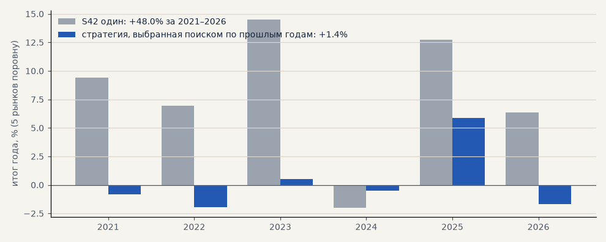

# Честный поиск второй стратегии (H54)

Перебор блоков ТЗ (как H50) на наборе для запуска: серебро и золото через CFD в обе стороны, GAZP, SBER, LKOH на бирже только в лонг. Отбор — только по 2016–2020: не меньше 50 сделок за выбор, корреляция месяцев с S42 ниже 0.3, цель — PF, устойчивая оценка (медиана PF пробы и 6 соседей) не ниже 1.2; финалисты — по приросту t месяцев портфеля «S42 + стратегия» на выборе. Проверка 2021–2026 — один раз, финалисты — штатным минутным симулятором. Расчёт — `scripts/second_search.py`.

> Хранение (20.10): база проб `reports/second_search/trials.sqlite` (1.75 ГБ) удалена после вывода. Итоги всех проб (оценки, PF и сделки на выборе и проверке, связь с S42, параметры) — `reports/second_search/trials_compact.parquet`, walk-forward поиска — `walk_forward.csv`, финалисты — `finalists.csv`. Пересчитать `report` по базе можно только новым поиском.

Проб: **1 029 487** (случайных 883 473); прошли отбор на выборе (сделки  связь с S42  PF > 1): 54 767; устойчивых (оценка ≥ 1.2): 588.

<!-- вывод -->
## Вывод

**H54 не подтвердилась: поиск по блокам ТЗ второй стратегии не даёт, даже с новой целью отбора.**

* **Сам поиск как метод** (walk-forward: на каждый год — лучшая стратегия по прошлым годам) за 2021–2026 заработал
  **+1.4%** против **+48%** у S42 — шесть лет около нуля. Это честная оценка того, что дал бы поиск, если бы мы ему
  доверились.
* **Правило отбора целиком** не лучше случая: у 588 устойчивых проб, отобранных только по 2016–2020, медианный PF
  проверки 1.11, а портфель с S42 лучше одного S42 по t лишь у 46%. Связь PF «выбор → проверка» среди них
  **отрицательная (−0.41)**: чем лучше стратегия выглядела на выборе, тем хуже потом — классическая подгонка.
* **Главный финалист**, которого правило поставило первым (пробой дня NR7 в лонг при ADX > 25), на выборе — PF 2.24,
  на проверке — **0.87**. По заранее записанному правилу H54 — «не подтвердилась».
* **Один из пяти финалистов проходит критерий на проверке**: пробой 55 дней с фильтром EMA200 на 4 ч и
  ATR14/ATR100 > 1, выход по развороту Supertrend 4 ч, стоп 3 ATR — сам PF 1.68, итог без 2 лучших +14.9%, t 2.24;
  с S42 t 2.42 против 1.93 и итог к просадке 4.78 против 3.85, корреляция с S42 0.10. Это то же семейство, что
  S31 (пробой 55 дней, «Черепахи»), — согласуется с тем, что пробои уровней лучшие входы во всём переборе
  (blocks.md). Но он выбран из пяти уже после взгляда на проверку — **кандидат, а не доказательство**.

**Итог по второй стратегии.** Честных кандидатов три, все с одной оговоркой — преимущество не доказано вне выборки:
RSI(2) Коннорса (не связан с импульсом, сам в плюсе в обоих периодах), S31 и этот вариант пробоя 55 дней. Их место —
бумажный режим рядом с запуском: сигналы считать, не торговать, и через полгода–год решать по живой статистике.
Перебор блоков ТЗ закрываем окончательно: два перебора (H50, H54) на 2.1 млн проб показали одно и то же.
<!-- /вывод -->

## Правило отбора целиком — что прошедшие показали на проверке

Все 588 устойчивых проб, отобранных только по 2016–2020. Это оценка самого правила отбора, а не удачной верхушки.

| PF проверки, медиана | доля с PF проверки > 1.1 | t портфеля с S42 на проверке, медиана | доля, где портфель лучше S42 по t | связь PF выбор → проверка | S42 один: t выбор / проверка |
|---|---|---|---|---|---|
| 1.11 | 52% | 1.92 | 46% | -0.41 | 1.28 / 1.97 |

## Walk-forward самого поиска — честная оценка

На каждый год берётся лучшая стратегия по годам до него (среди прошедших отбор) и торгует этот год.

| год | выбранная стратегия | PF до года | итог года, % | S42 за год, % | портфель пополам, % |
|---|---|---|---|---|---|
| 2021 | вход: inside bar → пробой · фильтр: перцентиль ATR > 0.5 + ADX 1ч > 25 · выход: Дончиан 10 ч · стоп 6 · ATR20 · размер по риску | 3.19 | -0.8 | +9.4 | +4.3 |
| 2022 | вход: NR7 + inside bar → пробой · фильтр: ADX 1ч > 20 + только лонг · выход: Supertrend 4ч · стоп 6 · ATR20 · размер по риску | 2.90 | -1.9 | +7.0 | +2.5 |
| 2023 | вход: NR7 → пробой · фильтр: перцентиль ATR > 0.5 + ADX 1ч > 25 · выход: Supertrend 4ч · стоп 6 · ATR10 · размер по риску | 2.56 | +0.5 | +14.5 | +7.5 |
| 2024 | вход: NR7 → пробой · фильтр: перцентиль ATR > 0.5 + ADX 1ч > 25 · выход: Supertrend 4ч · стоп 6 · ATR10 · размер по риску | 2.51 | -0.5 | -2.0 | -1.2 |
| 2025 | вход: NR7 + inside bar → пробой · фильтр: ADX 1ч > 20 + EMA50 дни · выход: Supertrend 4ч · стоп 6 · ATR20 · размер по риску | 2.40 | +5.9 | +12.7 | +9.3 |
| 2026 | вход: NR7 + inside bar → пробой · фильтр: ADX 1ч > 20 + EMA50 дни · выход: Supertrend 4ч · стоп 6 · ATR20 | 2.31 | -1.7 | +6.4 | +2.3 |
| **2021–2026** | | | **+1.4** | **+48.0** | **+24.7** |

## Финалисты — штатный минутный симулятор

| № | стратегия | период | сделок в год | итог % | PF | без 2 лучших | t мес | с S42: t мес (S42 один) | с S42: итог/просадка (S42 один) | корр. с S42 | устойч. оценка |
|---|---|---|---|---|---|---|---|---|---|---|---|
| 1 | вход: NR7 → пробой · фильтр: только лонг + ADX 1ч > 25 · выход: Дончиан 20 дней · стоп 6 · ATR10 · размер по риску | выбор | 22.8 | +27.6 | 2.24 | 22.2 | 3.13 | 2.38 (1.33) | 4.55 (2.46) | 0.08 | 2.10 |
| 1 | вход: NR7 → пробой · фильтр: только лонг + ADX 1ч > 25 · выход: Дончиан 20 дней · стоп 6 · ATR10 · размер по риску | проверка | 23.3 | -6.6 | 0.87 | -17.8 | -0.49 | 1.39 (1.93) | 2.81 (3.85) | 0.08 | 2.10 |
| 2 | вход: пробой 55 дней + 0.25 ATR · фильтр: ATR14/ATR100 > 1 + EMA200 4ч · выход: Supertrend 4ч · стоп 3 · ATR10 | выбор | 37.8 | +28.0 | 1.88 | 19.9 | 2.81 | 2.20 (1.33) | 4.06 (2.46) | 0.08 | 2.10 |
| 2 | вход: пробой 55 дней + 0.25 ATR · фильтр: ATR14/ATR100 > 1 + EMA200 4ч · выход: Supertrend 4ч · стоп 3 · ATR10 | проверка | 38.3 | +5.8 | 1.13 | 0.7 | 0.58 | 1.83 (1.93) | 3.36 (3.85) | 0.08 | 2.10 |
| 3 | вход: пробой 55 дней · фильтр: EMA200 4ч + ATR14/ATR100 > 1 · выход: Supertrend 4ч · стоп 3 · ATR20 · размер по риску | выбор | 40.2 | +27.7 | 1.87 | 21.3 | 2.76 | 2.20 (1.33) | 3.99 (2.46) | 0.10 | 1.78 |
| 3 | вход: пробой 55 дней · фильтр: EMA200 4ч + ATR14/ATR100 > 1 · выход: Supertrend 4ч · стоп 3 · ATR20 · размер по риску | проверка | 40.6 | +22.5 | 1.68 | 14.9 | 2.24 | 2.42 (1.93) | 4.78 (3.85) | 0.10 | 1.78 |
| 4 | вход: keltner:20:10:2 @24h · фильтр: EMA200 дни · выход: обратный сигнал · стоп 6 · ATR14 · размер по риску | выбор | 54.4 | +26.7 | 1.48 | 20.7 | 1.96 | 1.97 (1.33) | 3.63 (2.46) | 0.10 | 2.09 |
| 4 | вход: keltner:20:10:2 @24h · фильтр: EMA200 дни · выход: обратный сигнал · стоп 6 · ATR14 · размер по риску | проверка | 54.9 | +9.0 | 1.12 | 1.9 | 0.62 | 1.84 (1.93) | 3.45 (3.85) | 0.10 | 2.09 |
| 5 | вход: пробой 20 дней + 0.25 ATR · фильтр: EMA200 дни · выход: Дончиан 20 дней · стоп 3 · ATR10 | выбор | 65.4 | +22.3 | 1.36 | 14.3 | 1.78 | 1.85 (1.33) | 3.19 (2.46) | 0.09 | 1.72 |
| 5 | вход: пробой 20 дней + 0.25 ATR · фильтр: EMA200 дни · выход: Дончиан 20 дней · стоп 3 · ATR10 | проверка | 67.1 | +10.2 | 1.13 | 4.3 | 0.81 | 1.88 (1.93) | 3.41 (3.85) | 0.09 | 1.72 |
