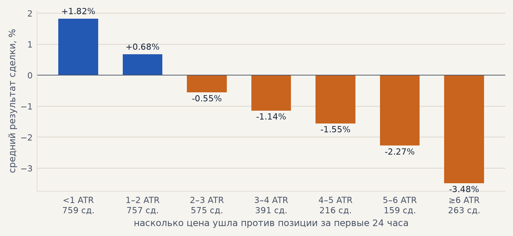
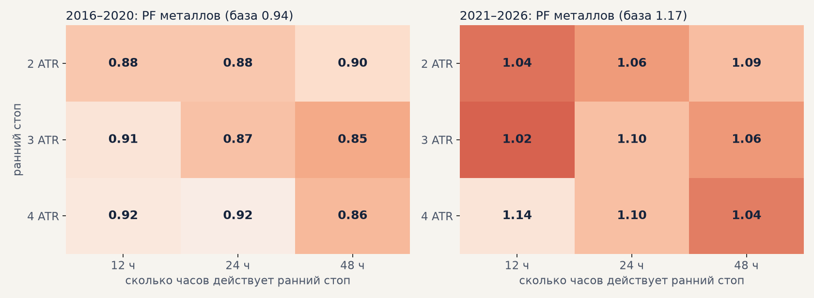

# Импульс на честной базе: можно ли отсечь убыточные сделки (неделя 12.10)

План созвона 11.10: прежде чем запускать торговлю, полнедели потратить на то, чтобы отсечь явно
убыточные сделки импульса. Всё считается против новой базы **B01** и по протоколу журнала: правило
выбирается по сделкам 2016–2020, проверка 2021–2026 — один раз. Расчёты —
`scripts/strategy_week_1012.py`, таблицы — [strategy_week_1012/summary.txt](strategy_week_1012/summary.txt).

## 0. Новая база B01

S03 (цены акций скорректированы на дивиденды, стоп по гэпу, комиссия 0.04%) плюс проскальзывание
0.05% на входе и на выходе плюс свопы за перенос позиции по условиям Альфа-Форекс (серебро с шагом
0.001). Профиль — `configs/costs/base.yaml`. Все эксперименты стратегии и модели в
[журнале](https://claude.ai/artifact/E4teCbCVvojCf96CJy9UQU) пересчитаны против B01; эксперименты, у
которых меняется путь сделки (S10, S14–S16), перепрогнаны штатным симулятором на всех 8 рынках
(`scripts/queues/base1.sh`).

| | весь период | проверка 2021–2026 | PF на проверке |
|---|---|---|---|
| S03, комиссия 0.04% | +170% | +95% | 1.37 |
| S04, + проскальзывание 0.05% | +131% | +73% | 1.27 |
| **B01, + свопы — портфель 4** | **−15%** | **−2%** | **0.99** |
| B01 — металлы (серебро + золото) | +30% | +41% | 1.17 |

Свопы акций через CFD (0.068% в день в обе стороны, около 5–6 переносов на сделку) съедают весь
доход. В плюсе остаются серебро (+58% на проверке), золото (+25%) и немного Сбербанк. На новой базе
ни одна прежняя доработка (выход 48/120/168 ч, узкий стоп, выход по развороту тренда, без
тренд-фильтра, фильтр волатильности, импульс 8 ч) базу не обогнала.

## 1. Что отличает убыточные сделки (H32, разведка)

Наблюдение Тимура подтвердилось: хорошие сделки почти не уходят в минус. Худший ход против позиции
(в ATR на входе), медиана по 3120 сделкам B01:

| | первые 6 ч | 12 ч | 24 ч | 48 ч |
|---|---|---|---|---|
| выигрышные | 0.9 | 1.1 | 1.35 | 1.5 |
| убыточные | 1.3 | 1.8 | 2.8 | 3.7 |

Но отсюда не следует, что ранний выход поможет. Сделка, ушедшая на 3–4 ATR против, в среднем
заканчивается на −1.1%, а выход на −3 ATR стоит около −1.6% (типичный ATR — 0.5% цены, плюс издержки):
часть таких сделок отыгрывается. Из крупных выигрышей (больше +2%) 12% успевают уйти против глубже
3 ATR за первые сутки.

## 2. Ранний стоп (H32, штатный симулятор) — не помогло

Правило: пока трейлинг не включился, первые eh часов после входа стоп стоит ближе — в es ATR от входа;
потом обычный стоп 6 ATR. Добавлено в симулятор (`simulation.early_stop_atr / early_stop_hours`,
токены варианта `es3:eh12`), сетка 2–4 ATR × 12–48 ч на всех 8 рынках (`scripts/queues/early_stop.sh`).

Цвет — отличие от базы (красный — хуже). На металлах все 9 вариантов хуже базы и на выборе, и на
проверке. По среднему PF металлов и портфеля 4 на выборе базу не обгоняет ни один вариант; лучший
(3 ATR, 12 ч) записан в журнал как **S23**: портфель 4 на проверке +6% против −2% (за счёт акций —
обрезанные сделки экономят свопы), металлы +6% против +41%. Вывод: ранний стоп режет отыгрывающиеся
сделки сильнее, чем экономит на проигрышных.

## 3. Выход из «застывших» сделок (H34) — не помогло

Через K часов трейлинг не включился и цена ближе Y ATR от входа — закрыть по закрытию часа (со
свопами держать такие сделки дорого). Быстрый расчёт поверх сделок B01, сетка K = 24–96 ч,
Y = 0.5–1.5 ATR. На металлах хуже базы во всех 12 вариантах выбора. Лучший на портфеле 4 по выбору
(72 ч, 1 ATR) на проверке хуже базы везде: портфель 4 −2% → −14%, металлы +41% → +22%.

## 4. Вход против уже ушедшей цены (H33) — связи нет

Результат сделки по ходу цены за 72 и 120 часов до сигнала в сторону сделки (только выбор
2016–2020): худшие корзины разбросаны по шкале, монотонной связи нет, сделки «против ушедшей цены» не
хуже остальных. Правила для фильтра нет — проверку не трогали. Так же было с запретом «против свечи»
на серебре.

## Что дальше

* Правила выхода и фильтры входа на импульсе исчерпаны: всё, что срезает сделки, срезает и крупные
  выигрыши. К запуску торговли — база B01 на **металлах**; акции — только если найдётся площадка без
  дорогого переноса (H04, H05).
* Главный открытый вопрос — шаг цены серебра у брокера (H19): металлы +41% при шаге 0.001 и +104%
  при 0.0001.
* Методологические темы к встрече в Казани — [kazan_prep.md](kazan_prep.md).
