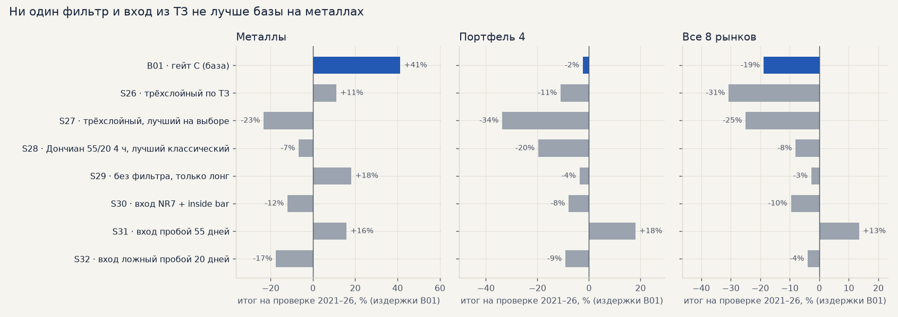
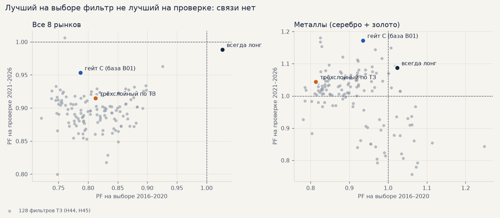
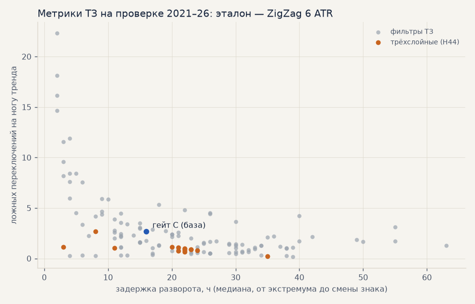

# ТЗ тренд-фильтра и перебор классических параметров (15.10.2026)

Проверка двух присланных текстов: ТЗ трёхслойного тренд-фильтра и списка популярных параметров
(EMA, MACD, ATR, каналы, ADX, NR7 / inside bar, уровни). Всё — на общем тесте журнала против базы
**B01** (импульс 6 ч / 3 ATR по гейту C, 8 рынков, дивиденды, стоп по гэпу, комиссия 0.04%,
проскальзывание 0.05% на сторону, свопы Альфа-Форекс; выбор — сделки 2016–2020, проверка — 2021–2026).
Гипотезы в банке: **H44–H49**. Эксперименты в журнале: **S26–S35**, **M18**.

## Главное

* **Ни один тренд-фильтр из ТЗ не лучше гейта C.** Трёхслойный фильтр как в ТЗ (S26): металлы на
  проверке +11% против +41% у базы, портфель 4 −11% против −2%. Лучший из 14 его вариантов на выборе
  (S27) и лучший из 111 классических (S28, Дончиан 55/20 на 4 ч) на проверке тоже хуже базы.
* **Подбор по прошлому не работает.** По 128 фильтрам ранговая связь «PF на выборе → PF на проверке»
  равна 0.01 (все рынки) и −0.31 (металлы). Лучшее на выборе — всегда случайно лучшее.
* **Гейт C — удача, а не умение.** На выборе он 90-й из 129, на проверке — 5-й (все рынки) и 2-й
  (металлы). Так же было в подборе 03.10 (99-й процентиль случайных гейтов). Значит, его +41% на
  металлах — частично удача периода 2021–26; на выборе металлы с гейтом C −11%.
* **«Всегда лонг» — лучший «фильтр» на выборе** (PF 1.03 против 0.79 у гейта C). На проверке
  металлы +18% (S29). Фильтры направления на часах угадывают не лучше дрейфа — как и в замере H37/H38.
* **Метрики ТЗ (задержка разворота и ложные переключения) с торговлей почти не связаны**
  (ранговая связь с PF 0.1–0.3). Трёхслойный фильтр в 3 раза реже «пилит» (1 ложное переключение на
  ногу тренда против 2.7 у гейта C), но замечает разворот позже (22 ч против 16) — и торгует хуже.
* **Компоненты как признаки модели (M18) и выходы из списка (S33–S35) — хуже базы**: признаки
  ухудшили CatBoost серебра на всех трёх seed; фиксированный тейк, Chandelier и выход по времени
  обрезают крупные ходы, на металлах все 13 выходов хуже базы.
* **Новые входы по паттернам.** Сжатие (NR7, NR4, inside bar) и ложный пробой хуже базы. Пробой
  55-дневного уровня («Черепахи», S31) — единственный вариант в плюсе и на выборе, и на проверке во
  всех срезах: портфель 4 +18% (PF 1.25) против −2%, все рынки +13% против −19%. Но сделок в 4 раза
  меньше, без 2 лучших ≈ 0, t < 1 — от шума не отличить, а на металлах хуже базы (+16% против +41%).

## 1. Как считали

* **Фильтры в коде** — два новых режима тренд-фильтра (`forexmodel/features/trend_score.py`):
  `mode: score` — трёхслойный фильтр ТЗ (все слои и параметры — опции `trend.score_*`), `mode: classic`
  — любой классический индикатор по спецификации `trend.rule` (`ema_cross:20:50`, `macd:12:26:9:sig`,
  `supertrend:10:3`, `donchian:55:20`, …) на 1 ч, 4 ч или днях. Как гейт C: только закрытые бары,
  старший ТФ пересчитывается каждый час из только что закрытого окна. Тесты на заглядывание вперёд —
  `tests/test_trend_score.py` (у каждого индикатора на 1 ч / 4 ч / 24 ч значение бара не меняется,
  если изменить будущее).
* **Быстрый и точный перебор** (`scripts/trend_grid.py`). Все сигналы импульса без фильтра один раз
  прогоняются штатным симулятором — у каждого своя сделка с издержками B01. Фильтр только решает,
  брать ли сигнал, а сделки без перекрытия отбираются той же цепочкой, что в симуляторе. Сверка:
  гейт C через перебор воспроизводит все сделки B01 (металлы −11.49% / +41.30% до сотых), лишние
  1–4 сделки на рынок — только на стыке лет. Финалисты пересчитаны штатным walk-forward
  (`scripts/queues/tz_1015.sh`) — цифры совпали с перебором.
* **Подвох, найденный по дороге:** для дневного таймфрейма `1D` pandas молча игнорирует сдвиг сетки,
  и «ежечасный пересчёт дневки» обновлялся раз в сутки. Дневки считаются как `24h` (сдвиг работает);
  в старых прогонах проекта `1D` в гейтах не использовался.

## 2. Трёхслойный фильтр (H44)

Слои ТЗ: режим — знак (close − EMA200); быстрый скор — среднее трёх пар EMA (8/32, 16/64, 32/128),
каждая в волатильностях бара (σ доходности за 48 ч), обрезка ±3 и деление на 3, против режима
ослабляется вдвое; шок — |доходность часа| > 2.8σ задаёт направление сразу; гистерезис — вход при
скоре > 0.3, выход при < 0.

| вариант | PF выбор (все) | металлы: выбор | металлы: проверка | портфель 4: проверка | все: проверка | задержка, ч | ложных на ногу |
|---|---|---|---|---|---|---|---|
| **гейт C (база)** | 0.79 | −13% | **+42%** | **−3%** | **−17%** | 16 | 2.7 |
| ТЗ как есть (S26) | 0.81 | −42% | +11% | −13% | −32% | 22 | 1.0 |
| без шока | 0.85 | −8% | +21% | −8% | −27% | 35 | 0.2 |
| пары ×4 — лучший на выборе (S27) | 0.85 | −2% | −23% | −35% | −27% | 11 | 1.1 |
| порог входа 0.15 | 0.82 | −37% | +14% | −13% | −32% | 20 | 1.2 |
| окна от волатильности | 0.82 | −35% | +5% | −9% | −29% | 22 | 1.0 |
| удержание 6 ч | 0.82 | −33% | −9% | −16% | −50% | 22 | 0.8 |
| шок + пробой Дончиана 48 ч | 0.80 | −51% | +7% | −24% | −42% | 21 | 1.1 |
| пары ×24 (как на днях) | 0.80 | −6% | +30% | −25% | −45% | 3 | 1.1 |
| режим по дневной EMA200 | 0.80 | −44% | −4% | −15% | −34% | 23 | 0.9 |
| режим по 4ч EMA200 | 0.79 | −49% | +4% | −11% | −31% | 23 | 0.9 |
| удержание 24 ч | 0.79 | −43% | −6% | −27% | −45% | 22 | 0.7 |
| полный (дневной режим, удержание 12, Дончиан 48, окна от волат.) | 0.78 | −41% | −10% | −36% | −59% | 21 | 0.8 |
| порог входа 0.5 | 0.78 | −48% | −4% | −17% | −35% | 24 | 0.8 |
| KAMA вместо пар EMA | 0.75 | −47% | +2% | −48% | −48% | 8 | 2.7 |

Итог — после издержек B01, по сделкам. Ни один вариант не обогнал гейт C на проверке ни в одном срезе.
Каждый слой ТЗ делает то, что обещано (меньше пилы, гистерезис держит тренд), но для импульса это
не нужно: импульс сам входит после сильного хода, и фильтру достаточно не мешать.

## 3. Классические индикаторы (H45)

111 фильтров: одиночная EMA (9, 21, 50, 100, 200), наклон EMA, пары 9/21, 12/26, 20/50, 50/200 и
Фибоначчи 8/21, 13/34, 21/55, 34/89, MACD (12/26/9, 8/17/9, 5/35/5, 19/39/9 × пересечение с
сигнальной / знак / разворот гистограммы), Supertrend (10, 3), (7, 3), (10, 2), Дончиан 20/10 и
55/20, Кельтнер EMA20 ± 2·ATR10, Боллинджер (20, 2), ADX(14) > 20 / 25 с направлением по DI, KAMA —
каждый на 1 ч, 4 ч и днях.

| семейство | фильтров | лучший на выборе (все рынки, PF) | его PF выбор → проверка | его металлы, проверка | медиана семейства: металлы / портфель 4, проверка |
|---|---|---|---|---|---|
| пары EMA | 24 | 9/21 на 4 ч | 0.91 → 0.92 | +17% | 0% / −31% |
| одиночная EMA | 15 | EMA200 на 4 ч | 0.87 → 0.91 | −6% | +12% / −28% |
| наклон EMA | 9 | EMA200 за 10 баров, 4 ч | 0.88 → 0.88 | −21% | +3% / −33% |
| MACD | 36 | 12/26/9, знак, 4 ч | 0.88 → 0.90 | +3% | +6% / −36% |
| Supertrend | 9 | (7, 3) на днях | 0.88 → 0.93 | −36% | +9% / −34% |
| Дончиан | 6 | 55/20 на 4 ч (S28) | 0.93 → 0.96 | −7% | 0% / −25% |
| Кельтнер | 3 | на днях | 0.90 → 0.93 | −20% | −5% / −20% |
| Боллинджер | 3 | на днях | 0.90 → 0.93 | −26% | +9% / −20% |
| ADX | 6 | > 20 на днях | 0.83 → 0.82 | −42% | −10% / −42% |
| KAMA | 3 | на днях | 0.82 → 0.88 | +18% | +5% / −39% |
| **гейт C** | | | 0.79 → 0.95 | **+42%** | |

Лучше гейта C на металлах на проверке — один фильтр из 111 (знак цены против EMA9 на днях, +44%), а
на выборе он один из худших (−40%). По таймфреймам медианы почти одинаковы (PF на проверке 0.90–0.91).

## 4. Метрики ТЗ: задержка разворота и ложные переключения

Эталон разворотов — ZigZag по закрытиям часа с порогом 6 ATR (масштаб стопа импульса). Задержка —
часов от экстремума до первого бара фильтра в сторону новой ноги; ложное переключение — вход фильтра
в состояние против текущей ноги.

Две метрики, как и сказано в ТЗ, тянут в разные стороны: быстрые фильтры (MACD, KAMA, пары ×24)
замечают разворот за 2–10 ч, но пилят 5–20 раз за ногу; медленные (Кельтнер, Дончиан на днях) почти
не пилят, но опаздывают на 40–60 ч. Гейт C — посередине (16 ч, 2.7). Но связь метрик с торговлей
слабая: ранговая корреляция с PF проверки — задержка −0.08, ложные переключения 0.28 (то есть
фильтры, которые пилят чаще, торгуют даже чуть лучше). Хорошая разметка тренда и хороший гейт
импульса — разные задачи (это же было 03.10 с подбором «по следованию тренду»).

## 5. Новые входы: сжатие диапазона и уровни (H46, H47)

Отдельный источник сигнала `signal_source: pattern` (`forexmodel/simulation/patterns.py`), выход как
у базы, с гейтом C и без. Дневные свечи — календарный день; уровень дня известен только после его
окончания. NR7 считается на дневках, а не на часах (на часах он ловил бы тихие азиатские часы).

| вход | гейт | сделок, проверка (все) | все: выбор / проверка | портфель 4: выбор / проверка | металлы: выбор / проверка |
|---|---|---|---|---|---|
| **база B01 — импульс** | C | 1924 | −41% / −19% | −12% / −2% | −11% / **+41%** |
| NR7 | C | 673 | −8% / −46% | −9% / −41% | +6% / −18% |
| NR4 | C | 1066 | −16% / −59% | −13% / −33% | −15% / −44% |
| inside bar | C | 759 | +3% / −24% | +6% / −26% | −7% / −41% |
| NR7 + inside bar (S30) | C | 324 | +5% / −10% | +10% / −8% | +12% / −12% |
| пробой вчерашнего дня | C | 2037 | −55% / −54% | −53% / −71% | −35% / −42% |
| пробой 20 дней | C | 762 | −2% / +6% | +2% / +5% | +31% / −17% |
| **пробой 55 дней (S31)** | C | 440 | 0% / **+13%** | +8% / **+18%** | +40% / +16% |
| ложный пробой 20 дней (S32) | C | 44 | +2% / −4% | +2% / −9% | +2% / −17% |
| те же без гейта | — | | хуже или около того — кроме пробоя 20 дней (все +10%, портфель 4 +13% на проверке; металлы −13%) | | |

Пробой 55 дней по гейту C: PF на проверке 1.15 (все), 1.25 (портфель 4), 1.26 (металлы); без 2
лучших сделок −1…+4%; t 0.8–0.9; в плюсе 4 года из 6. Это классические параметры «Черепах», а не
подобранные, но выбор из 16 вариантов входа всё равно был; и главное — на металлах, где сейчас
кандидат к запуску, он хуже базы. Держим как кандидата для отдельной проверки (например, как второй
независимый поток сделок к импульсу), но не замену базе.

## 6. Компоненты как признаки модели (H48, M18)

Совет ТЗ — подавать компоненты модели, а не резать ими сделки. Опция
`features.use_trend_score_features` добавляет CatBoost серебра 14 признаков: быстрый скор, режим,
шок, ER, итоговый скор; расстояние до 20-дневных максимума и минимума в ATR, положение в
диапазоне, часов с экстремума, силу пробоя вчерашнего дня, вчерашние NR7 и inside bar (тест
причинности — `test_trend_score_features_are_causal`). Walk-forward 2019–2026, те же seed и
настройки, что у базы M13:

| | итог до свопов, seed 42 / 7 / 1 | t сделки до комиссии | проверка 2021–26 с издержками B01 |
|---|---|---|---|
| M13, база | +77 / +95 / +105% | 2.8 / 3.2 / 3.6 | −53%, PF 0.91 |
| M18, + признаки ТЗ | +76 / +34 / +49% | 2.8 / 2.1 / 2.4 | −106%, PF 0.83 |

**Хуже на всех трёх seed** — как признаки слабой зоны EMA5 (M17) и отбор признаков (H30): новые
колонки у этой модели только добавляют разброс обучения.

## 7. Выходы из списка параметров (H49, S33–S35)

Вход — импульс базы; 13 выходов из ТЗ на 8 рынках (`scripts/queues/tz_exits.sh`, токены
`sl<ATR>` / `tp<ATR>` / `h<часов>` / `tr<ATR>:act0`).

| выход | все: выбор / проверка | портфель 4: выбор / проверка | металлы: выбор / проверка |
|---|---|---|---|
| **база: стоп и трейлинг 6 ATR, ≤ 240 ч** | −41% / −19% | −12% / −2% | −11% / **+41%** |
| по времени 10 ч | −15% / −26% | −6% / −18% | −32% / −41% |
| по времени 20 ч (S33, лучший на выборе) | −12% / −10% | −5% / +2% | −25% / −29% |
| по времени 50 ч | −34% / −22% | −26% / −17% | −36% / −9% |
| Chandelier 3 ATR с первой минуты (S34) | −34% / −21% | −18% / −8% | −24% / −27% |
| стоп 1.5 × тейк 2 / 3 / 4 ATR | −41…−38% / −60…−39% | | −51…−40% / −87…−69% |
| стоп 2 × тейк 2 / 3 / 4 ATR | −39…−30% / −41…−20% | | −49…−44% / −68…−44% |
| стоп 3 × тейк 2 / 3 / 4 ATR (S35 — тейк 4) | −41…−34% / −30…−21% | −27…−10% / −2…+6% | −41…−31% / −9…+11% |

Ни один выход не лучше базы на металлах. Короткие выходы выглядят лучше на «всех рынках» только
потому, что акции через CFD меньше платят свопов (на бирже это уже решено S25). Тейк и узкий трейлинг
обрезают редкие крупные ходы, из которых и складывается прибыль импульса (без 2 лучших сделок
база металлов +23% из +41%). Совпадает с прежней сеткой выхода (плато 168–240 ч, 6 ATR).

## Что дальше

* Тренд-фильтр на часах как источник улучшений исчерпан окончательно: 128 фильтров ТЗ, подбор 03.10
  и замер H37/H38 сходятся. Гейт C оставляем (он не хуже), но его +41% на металлах — с запасом на
  удачу периода; на выборе металлы с ним −11%.
* Кандидат — пробой 55 дней как дополнительный поток сделок; проверять сразу в паре с импульсом
  (общий портфель, корреляция сделок) и на свежих данных.

## Где что лежит

* Код: `forexmodel/features/trend_score.py` (режимы score / classic), `forexmodel/simulation/patterns.py`
  (паттерны входа), токены walk-forward `gate<имя>`, `pattern:…`, `sl<ATR>` / `tp<ATR>`.
* Перебор: `scripts/trend_grid.py` (candidates → grid → quality), результаты `reports/trend_grid/` (копии таблиц — [trend_tz/grid/](trend_tz/grid/): все 128 фильтров, метрики ТЗ).
* Прогоны: `scripts/queues/tz_1015.sh`, `tz_features.sh`, `tz_exits.sh`; графики — `scripts/trend_tz_charts.py`.
* Журнал экспериментов: S26–S32 и далее, [страница](https://claude.ai/artifact/E4teCbCVvojCf96CJy9UQU).
