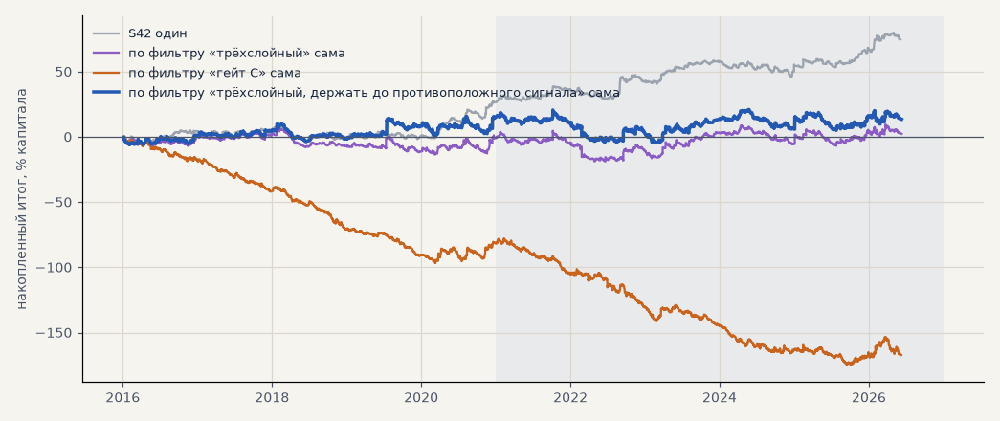

# Сделки по самому тренд-фильтру (H59)

Созвон 18.10: «а что, если открытие сделок по тренд-фильтру — совсем простенько». Набор для запуска: серебро и золото через CFD в обе стороны, GAZP, SBER, LKOH на бирже только в лонг. Вход по открытию часа после того, как фильтр включил направление, выход — после того, как вышел из него; без стопа и без подбора. Издержки — как в журнале (металлы B01, акции — биржа). Расчёт — `scripts/trend_follow.py`.

<!-- вывод -->
## Вывод

**H59 не подтвердилась: «следовать трёхслойному фильтру» на наборе для запуска даёт ноль.** PF 1.00 на проверке и
1.01 на выборе, итог без 2 лучших в минусе. Фильтр часто уходит в нейтраль и обратно — 340–400 сделок в год на пять
рынков по 2–4 дня, и каждая платит издержки. По гейту C ещё хуже (−87% на проверке): он «пилит» в 2.5 раза чаще.

* **Металлы** тянут вниз: серебро и золото в минусе в обоих периодах (на проверке −68% и −62%). Короткие
  переключения на металлах — шум, и CFD добавляет свопы.
* **Акции в лонг** по фильтру — в плюсе на всех трёх бумагах и в обоих периодах (вариант «держать до
  противоположного сигнала»: SBER PF 2.43 / 1.44, GAZP 1.78 / 1.27, LKOH 1.87 / 1.09). Но это вариант, придуманный
  после основного расчёта, и часть результата — просто рост рынка: на выборе фильтр везде отстаёт от «купить и
  держать» (акции росли, а он в рынке 58–62% времени), на проверке GAZP +55% против −25% у держания — ушёл от
  падения 2022 года, SBER +81% против +74%, LKOH +20% против +101%.

**Что с этим делать:** завёл отдельную гипотезу **H60** — «акции в лонг по трёхслойному фильтру против купить и
держать», со сравнением на единицу риска (не по сумме) и как второй стратегии к импульсу; в банке — статус «новая»,
ждёт приоритизации после чистки.
<!-- /вывод -->

## Проверка 2021 — июнь 2026

| стратегия | сделок в год | итог % | PF | без 2 лучших | просадка | t мес | с S42: итог % | t мес | итог / просадка | корр. месяцев с S42 |
|---|---|---|---|---|---|---|---|---|---|---|
| **S42 один** | 163.6 | +47.0 | 1.26 | +34.7 | -12.2 | 1.93 | — | 1.93 | 3.85 | — |
| по фильтру «трёхслойный» | 404.9 | -0.7 | 1.00 | -11.3 | -23.5 | -0.03 | +23.2 | 1.11 | 1.42 | 0.43 |
| по фильтру «гейт C» | 985.5 | -86.9 | 0.82 | -95.9 | -96.8 | -3.25 | -20.0 | -0.90 | -0.55 | 0.51 |
| по фильтру «трёхслойный, держать до противоположного сигнала» | 332.3 | -5.5 | 0.98 | -16.3 | -25.1 | -0.20 | +20.8 | 0.97 | 1.23 | 0.39 |

## Выбор 2016–2020

| стратегия | сделок в год | итог % | PF | без 2 лучших | просадка | t мес | с S42: итог % | t мес | итог / просадка | корр. месяцев с S42 |
|---|---|---|---|---|---|---|---|---|---|---|
| **S42 один** | 147.0 | +27.5 | 1.19 | +19.9 | -11.2 | 1.33 | — | 1.33 | 2.46 | — |
| по фильтру «трёхслойный» | 339.9 | +2.9 | 1.01 | -8.5 | -19.8 | 0.14 | +15.2 | 0.82 | 1.07 | 0.61 |
| по фильтру «гейт C» | 875.2 | -80.3 | 0.78 | -85.7 | -96.7 | -3.96 | -26.4 | -1.37 | -0.54 | 0.78 |
| по фильтру «трёхслойный, держать до противоположного сигнала» | 266.2 | +19.0 | 1.09 | +3.2 | -13.5 | 0.81 | +23.2 | 1.26 | 1.92 | 0.40 |

## По рынкам — трёхслойный, проверка

| рынок | сделок | итог % | PF | средняя сделка % | средняя длительность, дней |
|---|---|---|---|---|---|
| silver | 720 | -68.3 | 0.88 | -0.09 | 2.2 |
| gold | 720 | -61.7 | 0.81 | -0.09 | 2.2 |
| gazp | 255 | +47.2 | 1.23 | +0.19 | 3.0 |
| sber | 249 | +69.9 | 1.40 | +0.28 | 3.7 |
| lkoh | 253 | +9.7 | 1.04 | +0.04 | 3.5 |
