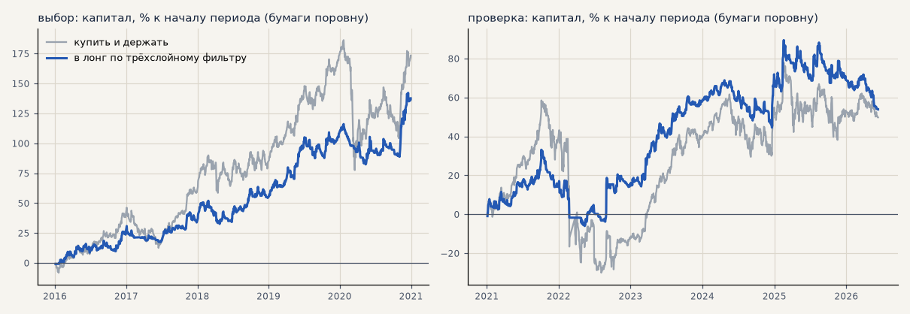

# Акции в лонг по трёхслойному фильтру против «купить и держать» (H60)

Вариант из разбора H59 ([trend_follow.md](trend_follow.md)): GAZP, SBER, LKOH в лонг, пока трёхслойный фильтр не покажет вниз (нейтраль не закрывает), без стопа и подбора; цены с поправкой на дивиденды, издержки биржи на каждый вход. Оба варианта — правило и «купить и держать» — считаются на капитале с реинвестированием по стоимости позиции на закрытии каждого часа (сделки правила — от дней до 2–3 месяцев, по закрытым сделкам просадка выглядела бы меньше настоящей), просадка — от пика капитала; у каждой бумаги своя треть капитала. В каждом периоде — покупка в его начале. Расчёт — `scripts/trend_hold.py`.

Критерий H60: на единицу риска (t месяцев и итог к просадке) лучше держания в обоих периодах — **да**; портфель с акциями S42 лучше одних акций S42 по t и итогу к просадке в обоих периодах — **нет**.

<!-- вывод -->
## Вывод

**H60 не подтвердилась целиком: против «купить и держать» — да, как вторая стратегия к импульсу — нет.**

* **Против держания правило лучше на единицу риска в обоих периодах:** t месяцев 2.77 против 2.37 на выборе и
  1.33 против 0.98 на проверке, итог к просадке 8.8 против 4.6 и 1.8 против 0.9. Просадка вдвое меньше (−16% против
  −38%, −29% против −56%): правило в рынке 54–59% времени и выходит до больших падений — GAZP на проверке +47% против
  −26% у держания, у SBER просадка −40% против −74%. Цена — меньший итог в росте: на выборе +138% против +173%.
* **Не на всех бумагах:** LKOH на проверке по фильтру +19% против +101% у держания — фильтр выходил и пропускал рост.
* **Второй стратегией к импульсу не годится:** месяцы правила и акций S42 сильно связаны (корреляция 0.75–0.79 —
  обе держат те же бумаги в лонг в те же тренды). Портфель лучше одних акций S42 на выборе (t 2.67 против 2.13), а
  на проверке хуже (t 1.55 против 1.62, итог к просадке 3.26 против 3.65).
* **Оговорка:** вариант «держать до противоположного сигнала» придуман после расчёта H59 — даже первая половина не
  доказательство.

**Что это значит.** Фильтр — способ держать акции с меньшим риском, чем просто купить, а не источник дохода сверх
импульса. В набор для запуска его не добавляем; если понадобится долгосрочная позиция в акциях (не торговая
стратегия), выход по фильтру перед падениями — разумный вариант. В журнале экспериментов — S50 (и S49 для H59).
<!-- /вывод -->

## Правило против «купить и держать»

| период | вариант | итог % | t мес | просадка % | самая долгая просадка, дней | итог / просадка | в рынке |
|---|---|---|---|---|---|---|---|
| выбор | по фильтру | +137.7 | 2.77 | -15.6 | 296 | 8.82 | 59% |
| выбор | купить и держать | +173.4 | 2.37 | -38.0 | 343 | 4.57 | 100% |
| проверка | по фильтру | +53.9 | 1.33 | -29.4 | 558 | 1.83 | 54% |
| проверка | купить и держать | +49.8 | 0.98 | -55.9 | 936 | 0.89 | 100% |

## По бумагам

| период | бумага | по фильтру: итог % | просадка % | итог / просадка | держать: итог % | просадка % | итог / просадка |
|---|---|---|---|---|---|---|---|
| выбор | GAZP | +94.8 | -30.0 | 3.16 | +118.4 | -39.5 | 2.99 |
| выбор | SBER | +230.7 | -18.9 | 12.18 | +250.1 | -35.9 | 6.96 |
| выбор | LKOH | +87.4 | -19.4 | 4.52 | +151.9 | -44.1 | 3.44 |
| проверка | GAZP | +47.4 | -28.7 | 1.65 | -25.5 | -62.8 | -0.41 |
| проверка | SBER | +95.2 | -39.7 | 2.40 | +73.8 | -73.8 | 1.00 |
| проверка | LKOH | +18.9 | -39.3 | 0.48 | +101.0 | -49.9 | 2.02 |

## Сделки правила (как в журнале, по закрытым сделкам)

| период | сделок в год | итог % | PF | без 2 лучших | лет в плюсе |
|---|---|---|---|---|---|
| выбор | 57.0 | +99.8 | 2.01 | +73.4 | 5/5 |
| проверка | 114.3 | +51.9 | 1.25 | +33.8 | 5/6 |

## Вместе с импульсом: акции S42 и правило поровну

Поровну, ребалансировка раз в месяц: S42 — месячный результат журнала (сделки до 10 дней), правило — месячная доходность по стоимости позиции. Сравниваем по t месяцев и итогу к просадке.

| период | портфель | итог % | t мес | просадка % (по концам месяцев) | итог / просадка | корр. месяцев |
|---|---|---|---|---|---|---|
| выбор | акции S42 одни | +65.3 | 2.13 | -5.9 | 11.09 | — |
| выбор | акции S42 + правило | +99.4 | 2.67 | -6.5 | 15.24 | 0.75 |
| проверка | акции S42 одни | +58.5 | 1.62 | -16.0 | 3.65 | — |
| проверка | акции S42 + правило | +57.2 | 1.55 | -17.5 | 3.26 | 0.79 |
