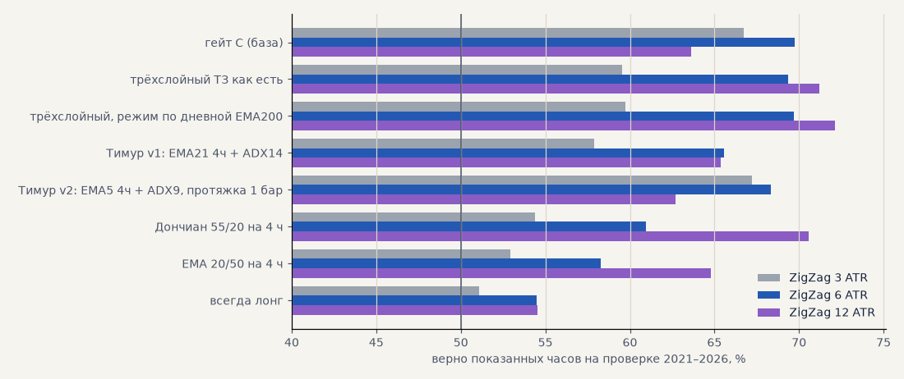
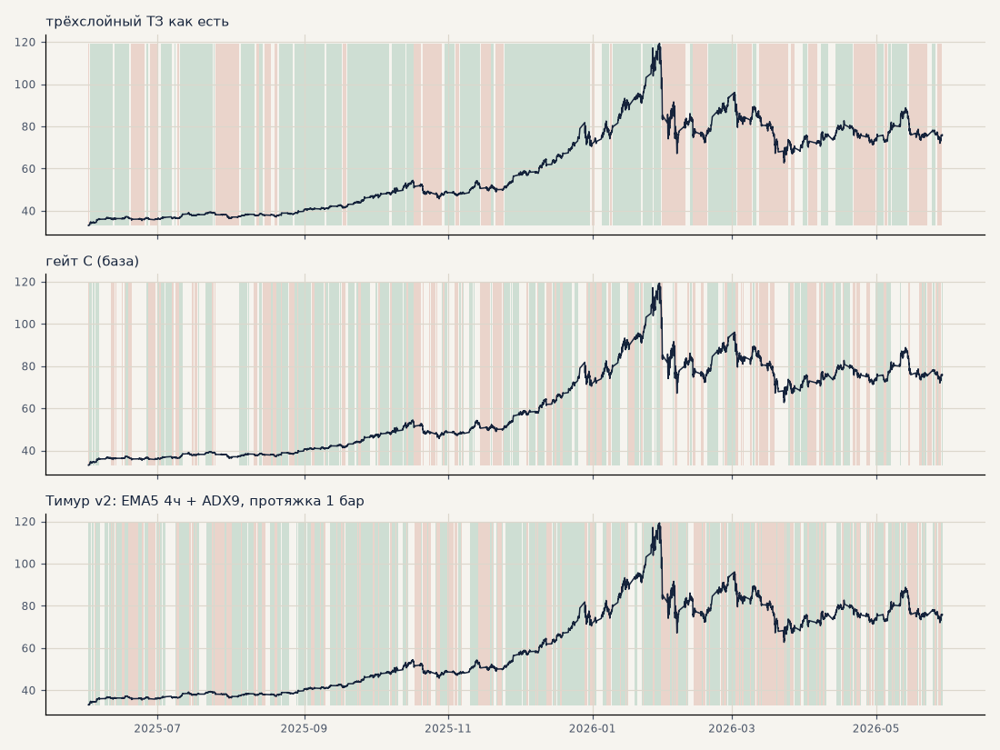

# Тренд-фильтр как разметка тренда для модели

Гипотеза **H55**, задачи **T23–T24**. Фильтр оцениваем не как гейт импульса, а как разметку: верно ли он показывает направление текущего тренда. Эталон тренда задним числом — ноги ZigZag по закрытиям часа на трёх масштабах: **3 ATR** (короткие движения), **6 ATR** (масштаб сделки импульса), **12 ATR** (долгий тренд). Рынки — серебро, золото, GAZP, SBER, LKOH, среднее по рынкам. Фильтры — как есть, без подбора, только по закрытым барам. Расчёт — `scripts/trend_labeling.py`.

* **верно** — доля часов, где знак фильтра совпадает с направлением ноги (среди часов, где фильтр не нейтрален);
* **говорит** — доля часов, где фильтр не нейтрален;
* **задержка** — медиана часов от начала ноги до первого бара фильтра в её сторону;
* **ложных** — входов фильтра в состояние против ноги внутри неё, в среднем на ногу;
* **ход 10 / 72** — средний ход цены за 10 и 72 бара в сторону фильтра, в ATR (у «всегда лонг» — просто дрейф).

<!-- вывод -->
## Вывод

**H55 подтвердилась наполовину: трёхслойный фильтр — лучшая разметка долгого тренда, но не короткого.**

* **Долгий тренд (ZigZag 12 ATR)** — трёхслойный фильтр лучший: верно 71–75% часов против 63–64% у гейта C,
  в 2.5–3 раза меньше ложных переключений на ногу (4 против 10–11), задержка на развороте 21–29 ч против 19 ч
  у гейта C. Дончиан 55/20 так же точен, но опаздывает на разворот на 4–5 суток. Это то, что Тимур увидел
  глазами: фильтр держит долгий тренд и переключается на развороте, а не мигает (картинка внизу).
* **Масштаб сделки импульса (6 ATR)** — трёхслойный наравне с гейтом C (68–70% у обоих), пилит в 3 раза реже,
  но замечает разворот на 4–8 ч позже. Поэтому как гейт импульса он не выиграл (S26) — импульсу важна скорость.
* **Короткие движения (3 ATR)** — лучший фильтр v2 Тимура (EMA5 на 4 ч + ADX9): верно 67%, задержка 7–8 ч;
  трёхслойный здесь слабый (59%). Зато на долгом тренде v2 пилит как гейт C.
* **Устойчивость.** Ход цены после «вверх» минус после «вниз» за 72 бара: трёхслойный с дневным режимом
  +0.78 ATR на выборе и +1.03 на проверке — умение есть в обоих периодах. У гейта C +0.30 и +1.08: на проверке
  он сильнее, чем был на выборе, — та же «удача периода», что нашли 15.10. Классические Дончиан и EMA 20/50
  на проверке слабеют вдвое–втрое.

**Метрика (T24):** доля верных часов, задержка и ложные переключения против ZigZag на трёх масштабах плюс
разница хода «после вверх − после вниз». Масштаб надо выбирать под задачу: для гейта импульса — 6 ATR и
задержка, для разметки долгого тренда — 12 ATR и ложные переключения.

**Что это значит для модели (T25):** разметка двух уровней — долгий тренд по трёхслойному фильтру (лучше с
дневным режимом) и короткий по быстрому фильтру (v2 Тимура или гейт C). Прошлая попытка дать компоненты
фильтра модели как признаки (M18) не помогла; следующий шаг — давать модели не компоненты, а готовые
состояния двух уровней и их согласие, или учить модель только по направлению долгого тренда.
<!-- /вывод -->

## ZigZag 3 ATR

| фильтр | период | верно | говорит | задержка, ч | ложных на ногу | ног |
|---|---|---|---|---|---|---|
| гейт C (база) | выбор | 65.0% | 71% | 12 | 0.7 | 535 |
| гейт C (база) | проверка | 66.7% | 70% | 12 | 0.7 | 686 |
| трёхслойный ТЗ как есть | выбор | 58.5% | 85% | 11 | 0.2 | 535 |
| трёхслойный ТЗ как есть | проверка | 59.6% | 86% | 10 | 0.2 | 686 |
| трёхслойный, режим по дневной EMA200 | выбор | 58.6% | 80% | 12 | 0.1 | 535 |
| трёхслойный, режим по дневной EMA200 | проверка | 59.8% | 81% | 10 | 0.2 | 686 |
| Тимур v1: EMA21 4ч + ADX14 | выбор | 57.6% | 100% | 9 | 0.2 | 535 |
| Тимур v1: EMA21 4ч + ADX14 | проверка | 57.9% | 100% | 9 | 0.2 | 686 |
| Тимур v2: EMA5 4ч + ADX9, протяжка 1 бар | выбор | 66.8% | 85% | 8 | 0.7 | 535 |
| Тимур v2: EMA5 4ч + ADX9, протяжка 1 бар | проверка | 67.2% | 88% | 7 | 0.8 | 686 |
| Дончиан 55/20 на 4 ч | выбор | 53.8% | 64% | 15 | 0.9 | 535 |
| Дончиан 55/20 на 4 ч | проверка | 54.4% | 65% | 15 | 1.0 | 686 |
| EMA 20/50 на 4 ч | выбор | 52.0% | 100% | 6 | 0.4 | 535 |
| EMA 20/50 на 4 ч | проверка | 52.9% | 100% | 6 | 0.4 | 686 |
| всегда лонг | выбор | 52.8% | 100% | 1 | 0.0 | 535 |
| всегда лонг | проверка | 51.1% | 100% | 1 | 0.0 | 686 |

## ZigZag 6 ATR

| фильтр | период | верно | говорит | задержка, ч | ложных на ногу | ног |
|---|---|---|---|---|---|---|
| гейт C (база) | выбор | 70.0% | 71% | 16 | 2.3 | 176 |
| гейт C (база) | проверка | 69.8% | 70% | 16 | 2.7 | 214 |
| трёхслойный ТЗ как есть | выбор | 68.0% | 85% | 23 | 0.7 | 176 |
| трёхслойный ТЗ как есть | проверка | 69.4% | 86% | 20 | 0.9 | 214 |
| трёхслойный, режим по дневной EMA200 | выбор | 68.0% | 80% | 24 | 0.6 | 176 |
| трёхслойный, режим по дневной EMA200 | проверка | 69.7% | 81% | 20 | 0.9 | 214 |
| Тимур v1: EMA21 4ч + ADX14 | выбор | 65.2% | 100% | 20 | 0.7 | 176 |
| Тимур v1: EMA21 4ч + ADX14 | проверка | 65.6% | 100% | 20 | 0.8 | 214 |
| Тимур v2: EMA5 4ч + ADX9, протяжка 1 бар | выбор | 68.7% | 85% | 8 | 2.8 | 176 |
| Тимур v2: EMA5 4ч + ADX9, протяжка 1 бар | проверка | 68.3% | 88% | 8 | 3.0 | 214 |
| Дончиан 55/20 на 4 ч | выбор | 59.8% | 64% | 50 | 2.6 | 176 |
| Дончиан 55/20 на 4 ч | проверка | 60.9% | 65% | 53 | 3.0 | 214 |
| EMA 20/50 на 4 ч | выбор | 56.7% | 100% | 34 | 1.0 | 176 |
| EMA 20/50 на 4 ч | проверка | 58.3% | 100% | 36 | 1.1 | 214 |
| всегда лонг | выбор | 55.8% | 100% | 2 | 0.0 | 176 |
| всегда лонг | проверка | 54.5% | 100% | 4 | 0.0 | 214 |

## ZigZag 12 ATR

| фильтр | период | верно | говорит | задержка, ч | ложных на ногу | ног |
|---|---|---|---|---|---|---|
| гейт C (база) | выбор | 63.4% | 71% | 19 | 11.4 | 44 |
| гейт C (база) | проверка | 63.6% | 70% | 19 | 10.3 | 62 |
| трёхслойный ТЗ как есть | выбор | 73.8% | 85% | 27 | 3.9 | 44 |
| трёхслойный ТЗ как есть | проверка | 71.2% | 86% | 21 | 4.2 | 62 |
| трёхслойный, режим по дневной EMA200 | выбор | 75.0% | 80% | 29 | 3.6 | 44 |
| трёхслойный, режим по дневной EMA200 | проверка | 72.1% | 81% | 22 | 3.9 | 62 |
| Тимур v1: EMA21 4ч + ADX14 | выбор | 68.2% | 100% | 24 | 3.8 | 44 |
| Тимур v1: EMA21 4ч + ADX14 | проверка | 65.4% | 100% | 24 | 3.5 | 62 |
| Тимур v2: EMA5 4ч + ADX9, протяжка 1 бар | выбор | 63.0% | 85% | 8 | 12.7 | 44 |
| Тимур v2: EMA5 4ч + ADX9, протяжка 1 бар | проверка | 62.7% | 88% | 8 | 11.4 | 62 |
| Дончиан 55/20 на 4 ч | выбор | 75.7% | 64% | 107 | 8.6 | 44 |
| Дончиан 55/20 на 4 ч | проверка | 70.6% | 65% | 105 | 9.4 | 62 |
| EMA 20/50 на 4 ч | выбор | 70.0% | 100% | 72 | 4.7 | 44 |
| EMA 20/50 на 4 ч | проверка | 64.8% | 100% | 74 | 4.1 | 62 |
| всегда лонг | выбор | 63.8% | 100% | 10 | 0.0 | 44 |
| всегда лонг | проверка | 54.5% | 100% | 24 | 0.0 | 62 |

## Ход цены после сигнала, ATR

«В сторону фильтра» включает дрейф рынка (у «всегда лонг» — только дрейф). Умение фильтра без дрейфа — **разница**: средний ход после «вверх» минус после «вниз»; у фильтра без умения она около нуля.

| фильтр | период | в сторону, 10 баров | в сторону, 72 бара | разница, 10 баров | разница, 72 бара |
|---|---|---|---|---|---|
| гейт C (база) | выбор | +0.043 | +0.180 | +0.077 | +0.295 |
| гейт C (база) | проверка | +0.130 | +0.547 | +0.257 | +1.082 |
| трёхслойный ТЗ как есть | выбор | +0.067 | +0.513 | +0.092 | +0.704 |
| трёхслойный ТЗ как есть | проверка | +0.125 | +0.582 | +0.229 | +0.995 |
| трёхслойный, режим по дневной EMA200 | выбор | +0.074 | +0.572 | +0.100 | +0.776 |
| трёхслойный, режим по дневной EMA200 | проверка | +0.138 | +0.629 | +0.248 | +1.030 |
| Тимур v1: EMA21 4ч + ADX14 | выбор | +0.069 | +0.460 | +0.096 | +0.590 |
| Тимур v1: EMA21 4ч + ADX14 | проверка | +0.066 | +0.300 | +0.109 | +0.416 |
| Тимур v2: EMA5 4ч + ADX9, протяжка 1 бар | выбор | +0.043 | +0.188 | +0.071 | +0.271 |
| Тимур v2: EMA5 4ч + ADX9, протяжка 1 бар | проверка | +0.090 | +0.413 | +0.166 | +0.722 |
| Дончиан 55/20 на 4 ч | выбор | +0.095 | +0.671 | +0.101 | +0.717 |
| Дончиан 55/20 на 4 ч | проверка | +0.084 | +0.283 | +0.121 | +0.253 |
| EMA 20/50 на 4 ч | выбор | +0.069 | +0.493 | +0.081 | +0.557 |
| EMA 20/50 на 4 ч | проверка | +0.075 | +0.204 | +0.122 | +0.181 |
| всегда лонг | выбор | +0.145 | +1.112 | — | — |
| всегда лонг | проверка | +0.090 | +0.689 | — | — |

## Как фильтры размечают серебро (июнь 2025 — май 2026)

Зелёный — фильтр показывает тренд вверх, красный — вниз, без цвета — нейтрально.

