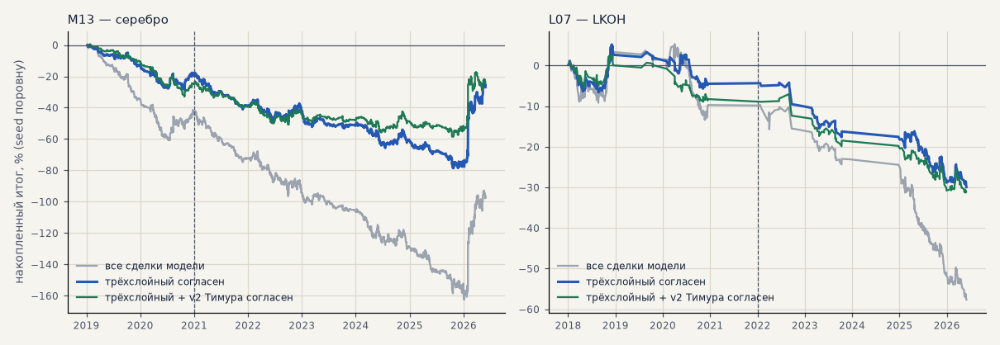

# Тренд-фильтр как фильтр сделок модели CatBoost (H58)

Созвон 18.10: находки по тренд-фильтру применить к текущей модели. Сделки модели не меняются — фильтр решает, брать ли сделку: лонг, если на последнем закрытом часе до входа фильтр показывает вверх, шорт — если вниз. Модели — прогоны журнала: **M13** (серебро, 3 seed; выбор 2019–2020, проверка 2021–2026) и **L07** (LKOH, годовой walk-forward; выбор 2018–2020, проверка 2022–2026). Издержки — как у прогонов (B01). Трёхслойный фильтр — с режимом по дневной EMA200 (H55); «+ v2 Тимура» — оба уровня показывают одно направление. Расчёт — `scripts/trend_model_gate.py`.

<!-- вывод -->
## Вывод

**H58 подтвердилась по критерию, но модель от этого прибыльной не становится.** Брать сделки CatBoost только по
направлению долгого тренда трёхслойного фильтра лучше, чем брать все, — у обеих моделей и в обоих периодах:

* **серебро (M13)**: PF 0.74 → 0.78 на выборе и 0.91 → 0.98 на проверке, t −2.11 → −1.41 и −1.11 → −0.18, убыток
  на проверке −53% → −7%; остаётся 58% сделок;
* **LKOH (L07)**: PF 0.90 → 0.92 и 0.58 → 0.64, t −0.65 → −0.42 и −3.57 → −2.35; остаётся 62% сделок.

Фильтр отсекает в основном сделки против долгого тренда — они у модели худшие. Но обе модели и после фильтра в
минусе: преимущества у модели нет, фильтр только уменьшает потери. **Согласие двух уровней** (трёхслойный + v2
Тимура) не лучше одного трёхслойного: на проверке серебра около нуля, но на выборе хуже (PF 0.65).

Проверка совмещения: «гейт C согласен» оставляет 99–100% сделок — модели и так обучены и торгуют внутри гейта C,
то есть время входа и состояние фильтра совмещены верно.

**Что дальше для модели:** трёхслойный фильтр брать в модель как обязательный фильтр направления (он даёт плюс в
обоих периодах), но искать преимущество самой модели надо в другом — в постановке задачи (T25: учить по
направлению долгого тренда или на разметке двух уровней), а не в фильтрах поверх неё.
<!-- /вывод -->

## M13 (серебро)

| вариант | период | доля сделок | сделок | итог % | PF | без 2 лучших | просадка | t | лет в плюсе |
|---|---|---|---|---|---|---|---|---|---|
| все сделки модели | выбор 2019-01–2020-12 | 100% | 494 | -44.5 | 0.74 | -51.3 | -61.4 | -2.11 | 0/2 |
| все сделки модели | проверка 2021-01–2026-05 | 100% | 1364 | -53.1 | 0.91 | -68.8 | -120.3 | -1.11 | 1/6 |
| трёхслойный согласен | выбор 2019-01–2020-12 | 58% | 267 | -19.6 | 0.78 | -21.6 | -28.8 | -1.41 | 0/2 |
| трёхслойный согласен | проверка 2021-01–2026-05 | 58% | 814 | -7.3 | 0.98 | -23.1 | -60.9 | -0.18 | 1/6 |
| трёхслойный + v2 Тимура согласен | выбор 2019-01–2020-12 | 45% | 194 | -25.0 | 0.65 | -27.0 | -33.4 | -2.08 | 0/2 |
| трёхслойный + v2 Тимура согласен | проверка 2021-01–2026-05 | 45% | 649 | +0.4 | 1.00 | -15.3 | -35.4 | 0.01 | 1/6 |
| гейт C согласен | выбор 2019-01–2020-12 | 100% | 494 | -44.5 | 0.74 | -51.3 | -61.4 | -2.11 | 0/2 |
| гейт C согласен | проверка 2021-01–2026-05 | 100% | 1364 | -53.1 | 0.91 | -68.8 | -120.3 | -1.11 | 1/6 |

## L07 (LKOH)

| вариант | период | доля сделок | сделок | итог % | PF | без 2 лучших | просадка | t | лет в плюсе |
|---|---|---|---|---|---|---|---|---|---|
| все сделки модели | выбор 2018-01–2020-12 | 100% | 302 | -9.7 | 0.90 | -16.9 | -18.7 | -0.65 | 1/3 |
| все сделки модели | проверка 2022-01–2026-06 | 100% | 377 | -47.9 | 0.58 | -55.3 | -48.0 | -3.57 | 0/5 |
| трёхслойный согласен | выбор 2018-01–2020-12 | 62% | 177 | -4.5 | 0.92 | -11.3 | -10.9 | -0.42 | 1/3 |
| трёхслойный согласен | проверка 2022-01–2026-06 | 62% | 241 | -25.5 | 0.64 | -32.4 | -25.8 | -2.35 | 0/5 |
| трёхслойный + v2 Тимура согласен | выбор 2018-01–2020-12 | 47% | 129 | -8.3 | 0.80 | -12.6 | -11.5 | -0.99 | 2/3 |
| трёхслойный + v2 Тимура согласен | проверка 2022-01–2026-05 | 47% | 193 | -22.9 | 0.61 | -28.4 | -24.3 | -2.38 | 0/5 |
| гейт C согласен | выбор 2018-01–2020-12 | 99% | 301 | -9.2 | 0.91 | -16.4 | -18.2 | -0.62 | 1/3 |
| гейт C согласен | проверка 2022-01–2026-06 | 99% | 371 | -47.2 | 0.58 | -54.5 | -47.2 | -3.52 | 0/5 |
